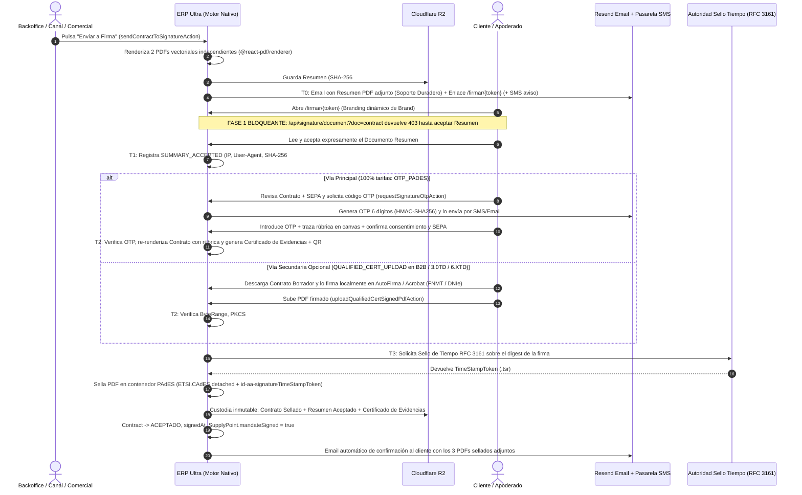

# Estrategia y Arquitectura del Motor Propio de Firma Digital y Contratación Multi-Comercializadora

**Plataforma:** ERP Ultra (`sp-erp-comercializadoras`)  
**Estado:** En Producción — 100% Implementado (Motor PDF Vectorial + Editor Modular de Cláusulas + Firma `PAdES` / `RFC 3161`)  
**Alcance:** 100% Multi-Sociedad (`Company`) y Multi-Marca (`Brand`) — Estándar único del ERP para todas las comercializadoras eléctricas  
**Marco Normativo Base:** Real Decreto 88/2026 (BOE 12/02/2026), Directiva (UE) 2019/944, Reglamento (UE) 910/2014 y 2024/1183 (**eIDAS / eIDAS 2**), Ley 6/2020 de Servicios Electrónicos de Confianza, RDL 1/2007 (TRLGDCU) y Normativa EPC SEPA (`CORE` / `B2B`).

---

## 1. Visión Estratégica y Principios Rectores

El objetivo cumplido con esta arquitectura es **eliminar por completo la dependencia tecnológica y económica de DocuSign** (tanto en la generación de plantillas Word/PDF como en el envío y sellado de sobres), dotando a **ERP Ultra** de un **Motor Nativo de Generación Contractual y Firma Electrónica Avanzada/Cualificada**.

### Principios Innegociables de Diseño
1. **El ERP marca el estándar (Multi-Comercializadora Nativo):** El motor pertenece al núcleo de ERP Ultra y funciona de manera idéntica y parametrizada para cualquier comercializadora (`Company` / `Brand`) dada de alta en la plataforma. Ninguna plantilla, logotipo, cláusula, fuero ni remitente SMS/Email queda fijado en código para una comercializadora concreta.
2. **Coste Marginal Mínimo (~0,13 € – 0,28 € por contrato firmado):** Frente a los **4,00 € – 5,50 €** por sobre de plataformas SaaS externas en volúmenes bajos/medios, el ERP genera internamente todos los PDFs a coste `0,00 €` y únicamente consume en el momento real de la firma **1 SMS OTP directo (~0,04 €–0,06 €)** y **1 Sello de Tiempo `RFC 3161` (~0,08 €–0,22 € en QTSA de pago)**. Los borradores no firmados tienen coste **`0,00 €`**.
3. **Plena Fuerza Probatoria ante CNMC, Consumo, Juzgados y Banca SEPA:** Todo contrato firmado queda sellado criptográficamente bajo estándar europeo **`PAdES-B-B` / `PAdES-B-T` (ETSI EN 319 142)** (`SubFilter /ETSI.CAdES.detached`) incorporando un **Sello de Tiempo `RFC 3161`** (`OID 1.2.840.113549.1.9.16.2.14`) y un **Certificado de Evidencias Electrónicas** con cadena de hashes inmutable (`SignatureAuditEvent`) y verificación pública mediante QR (`/verificar-firma/[code]`).
4. **Jerarquía Clara de Métodos de Firma:**
   - **Vía Principal Universal (100% de tarifas `2.0TD`, `3.0TD`, `3.0TDVE`, `6.1TD`–`6.4TD`):** Firma Digital Avanzada Nativa del ERP (`OTP_PADES`: aceptación previa del Documento Resumen + validación OTP SMS/Email + rúbrica biométrica táctil/ratón + sellado PAdES + RFC 3161). Siempre disponible y prioritaria para no frenar jamás una venta.
   - **Vía Secundaria Opcional (`QUALIFIED_CERT_UPLOAD` en Empresas / `3.0TD` y `6.1TD`–`6.4TD`):** Posibilidad voluntaria y no intrusiva de descargar el contrato borrador (únicamente **después** de haber aceptado el Documento Resumen en Fase 1) y subirlo firmado con **Certificado Digital Cualificado (`FNMT`, `Camerfirma`, `DNIe`, `Firmaprofesional`, `AutoFirma`)**, validado criptográficamente en servidor y contra-sellado con sello de custodia corporativo PAdES + `RFC 3161`. **Jamás es obligatoria; actúa siempre como alternativa secundaria corporativa.**

---

## 2. Fundamento Jurídico: El Documento Resumen y el Real Decreto 88/2026

### 2.1. ¿Puede ir el Documento Resumen como simple anexo del contrato o debe firmarse antes?
El **Real Decreto 88/2026, de 11 de febrero** (*Reglamento general de suministro, comercialización y agregación de energía eléctrica*, que desarrolla el Art. 10 de la Directiva UE 2019/944) exige dos garantías cuya carga de la prueba recae **al 100% sobre la comercializadora**:

1. **Independencia Documental:** El *Documento Resumen* **no puede diluirse dentro del clausulado ni presentarse como un mero apéndice final oculto tras las Condiciones Generales**. Debe constituir un **documento independiente y separado** del contrato principal (`SummaryPdfTemplate.tsx`), redactado en lenguaje claro y conciso con precios, fórmula de indexación, potencia, servicios adicionales, duración, desistimiento, advertencia de Bono Social y penalizaciones por baja anticipada.
2. **Prelación Temporal Acreditable (`T_resumen < T_contrato`) en Soporte Duradero:** La comercializadora debe demostrar fehacientemente ante una auditoría de la CNMC que el cliente **recibió en soporte duradero y aceptó el Documento Resumen ANTES de prestar su consentimiento contractual vinculante**.

### 2.2. ¿Por qué comercializadoras como Unieléctrica envían dos sobres separados (1º Resumen -> 2º Contrato)?
La ley **no exige dos correos separados en momentos distintos**, sino **independencia documental + constancia fehaciente de entrega y aceptación previa (`T1 < T2`)**.
- Cuando una comercializadora depende de una herramienta cerrada externa (como DocuSign estándar), si incluye el Resumen y el Contrato en un mismo sobre, el cliente pulsa *"Finalizar"* una sola vez y el proveedor certifica **un único instante de firma idéntico para ambos documentos (`T1 = T2`)**. Por esa limitación técnica de terceros, compañías como Unieléctrica dividen el proceso en **dos sobres separados**, asumiendo doble fricción comercial y doble coste por sobre.

### 2.3. Cómo lo resuelve el Motor Nativo de ERP Ultra
Al controlar internamente el motor documental, el endpoint de documentos (`/api/signature/document`), la ceremonia (`/firmar/[token]`) y la cadena de evidencias, cumplimos el **100% del rigor probatorio de `T0 < T1 < T2`** ofreciendo **dos modos configurables por marca (`Brand.signatureFlowMode`)**:

- **Modo A — Ceremonia Secuencial Bloqueante en 1 Enlace (`SEQUENTIAL_SINGLE_LINK`, Modo Estándar Activo por Defecto):**
  1. **`T0` (Entrega Precontractual en Soporte Duradero):** Al enviar a firma, el ERP genera **dos archivos PDF independientes** en Cloudflare R2 con hashes `SHA-256` propios (`resumen_precontractual_*.pdf` y `borrador_*.pdf`). El email de invitación adjunta directamente el PDF independiente del **Documento Resumen** en soporte duradero desde `T0`.
  2. **`T1` (Fase 1 Bloqueante — Lectura y Aceptación del Documento Resumen):** Al abrir `/firmar/[token]`, **el servidor bloquea con HTTP `403` cualquier descarga o visualización de `doc=contract` mientras `summaryAcceptedAt == null`**. El cliente visualiza únicamente el **Documento Resumen independiente**, puede descargarlo y debe marcar y confirmar su lectura y aceptación expresa (`acceptSummaryDocumentAction`). El ERP registra `SUMMARY_ACCEPTED` con marca temporal `T1`, IP, `User-Agent`, re-renderiza el Resumen con sello visible de aceptación precontractual y desbloquea la Fase 2.
  3. **`T2` (Fase 2 Desbloqueada — Firma del Contrato y Mandato SEPA, con `T2 > T1`):** Solo tras `T1` se habilita el visor del **Contrato + Mandato SEPA**, el envío del código **OTP SMS/Email** (o la pestaña secundaria de subida con Certificado Digital Cualificado en suministros habilitados) y la firma final.
- **Modo B — Doble Envío Separado estilo Unieléctrica (`TWO_STEP_SEPARATE_DELIVERY`, Configurable por Marca):**
  - El primer envío entrega únicamente la Fase 1 (**Documento Resumen**). Al aceptar el cliente en `T1`, el ERP registra `contractSentAt` y dispara automáticamente un segundo correo/SMS independiente invitándole a completar la Fase 2 (**Contrato de Suministro**).

---

## 3. Flujo Completo del Motor de Firma Nativo

---

## 4. Motor Multi-Comercializadora de Plantillas, Reglas `CORE` vs `B2B` y Cláusulas

Toda la generación documental reside en **`@react-pdf/renderer`** sin depender de archivos `.docx` ni de conversores externos:

### 4.1. Componentes Documentales Implementados
1. **Documento Resumen Precontractual Independiente (`src/components/pdf/SummaryPdfTemplate.tsx`):**
   - Cabecera corporativa multi-marca, identificación de comercializadora y suministro, tablas de potencia (`€/kW/año` y equivalencia diaria `€/kW/día`) y energía (fija `P1..P6` o fórmula indexada `OMIE` + `FEE`), autoconsumo/Bolsillo Solar, duración, permanencia, derecho de desistimiento diferenciado (`CORE` vs `B2B`), advertencia legal sobre pérdida del Bono Social PVPC en consumidores particulares y sello verde de aceptación precontractual expresa (`Fase T1`).
2. **Contrato de Suministro + Anexo Autoconsumo + Mandato SEPA (`src/components/pdf/ContractPdfTemplate.tsx`):**
   - Condiciones Particulares completas, Condiciones Económicas (Fijo o Indexado), Duración/Renovación/Penalizaciones, Cláusulas Generales filtradas dinámicamente según el perfil del contrato, Anexo de Compensación de Excedentes y Bolsillo Solar, y Orden de Domiciliación SEPA (`CORE` o `B2B`, omitida automáticamente si la forma de pago es `Transferencia`).
3. **Anexos de Modificación Técnica y Subrogación (`src/components/pdf/ContractModPdfTemplate.tsx`):**
   - Generación vectorial nativa para trámites `M1` (`MODTEC` y `SUBROGACION`).
4. **Certificado de Evidencias Electrónicas (`src/components/pdf/AuditCertificatePdfTemplate.tsx`):**
   - Documento pericial con todos los hitos cronológicos (`T0`, `T1`, `T2`, `T3`), hashes `SHA-256`, cadena `SignatureAuditEvent`, datos del certificado X.509 o validación OTP y código QR de verificación pública (`/verificar-firma/[code]`).

### 4.2. Distinción Automática `CORE` (Consumidor Particular) vs `B2B` (Empresas y Autónomos)
La función [`determineContractIsB2B`](file:///c:/Users/Administrator/sp-erp-comercializadoras/src/lib/contracts/contractPdfService.tsx#L31-L40) evalúa automáticamente cada contrato:
- **Consumidor Particular (`CORE`, `isB2B === false`):** Aplica estrictamente cuando el titular tiene un **DNI/NIE de persona física** (9 caracteres comenzando por `[0-9XYZ]`) **y** el `CNAE` es doméstico (**`9820`** o **`9821`**).
- **Régimen Empresarial / Profesional (`B2B`, `isB2B === true`):** Aplica a cualquier persona jurídica (`CIF`), comunidad de propietarios o persona física con `CNAE` de actividad económica/profesional distinto de `9820`/`9821`.

Esta clasificación adapta automáticamente **tanto las Condiciones Particulares como las Condiciones Generales**:
- **En Condiciones Particulares y Anexos:**
  - **Exclusión configurable de *Take or Pay* en `CORE` (`particularConfig.takeOrPayScope`):** Por defecto (`'B2B_ONLY'`, activo en **AED Energía**), la cláusula de *Consumo Mínimo Garantizado / Take or Pay* se imprime únicamente en contratos `B2B` y **queda excluida en Consumidor `CORE`**. Cada comercializadora puede ajustarlo en el editor (`B2B_ONLY`, `DISABLED` o `ALL`).
  - **Desistimiento gratuito de 14 días (`adminFeeConsumerText` vs `adminFeeB2BText`):** Reconocido expresamente para consumidores `CORE`.
  - **Información y advertencia sobre Bono Social (`bonoSocialConsumerNote`):** Se incluye automáticamente en contratos y resúmenes `CORE`.
  - **Mandato Bancario SEPA:** Esquema `SEPA CORE` (reembolso en 8 semanas) para particulares vs autorización `SEPA CORE / SEPA B2B` con texto específico empresarial para `B2B`.
- **En Condiciones Generales (`visibilityScope` por cláusula):**
  - Cada cláusula general soporta alcance condicional: `ALL`, `CONSUMER_ONLY`, `B2B_ONLY` (ej. **Cláusula 15: Imputación de Pagos** exclusiva de `B2B`), `FIXED_ONLY`, `INDEXED_ONLY`, `SELF_CONSUMPTION_ONLY` y `SOLAR_WALLET_ONLY`.
  - **Fuero Judicial Automático (`{{company.jurisdictionCity}}` — Cláusula 12.4):** Resuelto por [`resolveCompanyJurisdictionCity`](file:///c:/Users/Administrator/sp-erp-comercializadoras/src/lib/contracts/defaultClauses.ts#L456-L486) a partir de `Company.jurisdictionCity` o extrayendo automáticamente la ciudad del domicilio social `Company.address` / `Company.registroMercantil` (ej. **Córdoba** en **AED Energía** para clientes `B2B`, manteniendo siempre los Juzgados del domicilio del consumidor en contratos `CORE` conforme al RDL 1/2007).

### 4.3. Editor Modular de Cláusulas y Versionado Legal (`/marcas/[id]/plantilla-contrato`)
Accesible desde **Administración -> Marcas -> botón "Cláusulas Contrato"** (`SUPERADMIN` y `COMPANYADMIN`):
- Consta de 4 pestañas de edición: **Cláusulas Generales** (añadir, reordenar, activar/desactivar, editar `visibilityScope` e insertar variables `{{company.*}}` / `{{brand.*}}`), **Condiciones Particulares, Autoconsumo y Take or Pay**, **Mandato SEPA** y **Documento Resumen RD 88/2026**.
- Incluye **Previsualización PDF en Vivo** (`/api/contracts/template-preview`) con conmutador instantáneo entre `Contrato CORE`, `Contrato B2B`, `Modalidad Fija/Indexada` y `Documento Resumen`.
- **Versionado Inmutable (`ContractTemplateVersion`):** Guardar cambios crea/actualiza borradores o publica una nueva versión numerada (`v1`, `v2`...) sin alterar jamás la versión (`Contract.templateVersionId`) con la que se emitieron contratos históricos.

---

## 5. Arquitectura Criptográfica y Validación de Certificados (`src/lib/signature/cryptoPades.ts`)

### 5.1. Sellado Criptográfico `PAdES` + `RFC 3161` (`OTP_PADES`)
1. **Tokens y OTP Seguros:**
   - El enlace `/firmar/[token]` emplea un token entrópico de 256 bits (`base64url`). En BD se guarda `tokenHash` (`SHA-256`) para búsqueda indexada y `signingTokenEncrypted` (`AES-256-GCM`) para reenvíos autorizados.
   - El código OTP de 6 dígitos (`crypto.randomInt`) se almacena únicamente como `HMAC-SHA256`, con caducidad de `10 minutos`, límite de `5` intentos de verificación y enfriamiento anti-abuso de `45 s` (máximo `5` envíos por sobre).
2. **Firma `PAdES` Estándar ISO 32000-1 / ETSI EN 319 142:**
   - Se inyecta un diccionario `/Sig` (`/Filter /Adobe.PPKLite`, `/SubFilter /ETSI.CAdES.detached`) con reserva exacta de `/ByteRange` al final del PDF.
   - Se construye una estructura `CMS / PKCS#7 SignedData` con atributos autenticados `contentType`, `messageDigest` (`SHA-256`), `signingTime` e `id-aa-signingCertificateV2` (`ESSCertIDv2`, exigido por el perfil europeo PAdES).
   - Se solicita automáticamente un **Sello de Tiempo `RFC 3161`** (`TimeStampReq` ASN.1 DER -> `TimeStampResp`) al servidor TSA configurado en `RFC3161_TSA_URL` (con soporte de autenticación Basic/Bearer para QTSPs cualificados como Camerfirma/Firmaprofesional y fallback automático a TSA pública RFC 3161 como FreeTSA/DigiCert si no se han cargado credenciales de pago) e incrusta el token en el atributo no firmado `1.2.840.113549.1.9.16.2.14`.

### 5.2. Validación Estricta de Certificado Digital Cualificado (`QUALIFIED_CERT_UPLOAD`)
Cuando un cliente empresarial (`allowCertUploadFallback === true` en `B2B` o tarifas `3.0TD`/`6.XTD`) sube el contrato firmado con su propio Certificado Digital:
1. **Bloqueo Precontractual:** Rechaza la subida si `summaryAcceptedAt == null` (`RD 88/2026`).
2. **Verificación Matemática en 5 Capas (`verifyUploadedClientSignedPdf`):**
   - Presencia de diccionario `/Sig` y cobertura real de `/ByteRange` hasta el final de la revisión firmada (impidiendo inyección de páginas posteriores).
   - Extracción y parseo ASN.1 DER del contenedor `PKCS#7 / CMS` y verificación del `messageDigest` `SHA-256` contra los bytes exactos de `/ByteRange`.
   - Verificación criptográfica RSA de la firma digital sobre los atributos autenticados con la clave pública del certificado X.509 firmante y comprobación de su ventana de validez temporal (`notBefore` / `notAfter`).
   - Comprobación del emisor frente a Autoridades de Certificación reconocidas (`FNMT`, `Camerfirma`, `DNIe`, `Firmaprofesional`, `Izenpe`, `ANCERT`, `ACCGV`, `Uanataca`, `ACA`, `Sectigo`, `DigiCert`, `GlobalSign`, etc.).
   - Cotejo de identidad fiscal extrayendo `IDCES-...` / `VATES-...` / NIF/CIF del `Subject` (`serialNumber` y `organizationIdentifier`) y verificando coincidencia con el NIF/CIF del titular o del apoderado del contrato.
3. **Custodia y Evidencias:** Genera igualmente el **Certificado de Evidencias Electrónicas** sellado con `PAdES` + `RFC 3161` dejando constancia del `Subject DN`, `Issuer DN` y número de serie del certificado empleado.

---

## 6. Modelo de Datos en Producción (`prisma/schema.prisma`)

Modelos activos en PostgreSQL:
- **`Company`:** `sepaCreditorId`, `dpoEmail`, `jurisdictionCity`, `registroMercantil`, `ordenCnmc`.
- **`Brand`:** `freePhone900`, `withdrawalEmail`, `smsSenderId`, `signatureFlowMode` (`"SEQUENTIAL_SINGLE_LINK"` por defecto), `allowQualifiedCertUploadB2B` (`true`), `envelopeExpirationDays` (`14`).
- **`Contract`:** `templateVersionId`, `fileSummaryPdf` (además de `filePdfDraft`, `filePdfSigned`, `fileAnexoFirmado`, `signedAt` y `docusignEnvelopeId` mantenido por compatibilidad histórica).
- **`ContractTemplateVersion`:** Versiones modulares por marca (`versionNumber`, `status` `DRAFT | PUBLISHED | ARCHIVED`, `particularConfigJson`, `clausesJson`, `annexAutoconsumoJson`, `sepaMandateConfigJson`, `summaryConfigJson`, `publishedAt`).
- **`SignatureEnvelope`:** Estado completo del sobre (`envelopeCode`, `tokenHash`, `signingTokenEncrypted`, `status`, `flowMode`, `documentKind`, hashes y URLs en R2 de Resumen, Borrador, Contrato Sellado y Certificado de Evidencias, control de OTP, metadatos X.509 y sello `RFC 3161` `tsaProvider`/`tsaTimestamp`/`tsaTokenBase64`).
- **`SignatureAuditEvent`:** Registro inmutable encadenado criptográficamente (`prevEventHash` -> `eventHash` `SHA-256`) de cada acción (`ENVELOPE_CREATED`, `INVITATION_SENT`, `PORTAL_VIEWED`, `SUMMARY_ACCEPTED`, `OTP_SENT`, `OTP_FAILED`, `OTP_VERIFIED`, `QUALIFIED_CERT_VERIFIED`, `CONTRACT_SIGNED_SEALED`, `ENVELOPE_CANCELLED`).

---

## 7. Gobierno de Permisos RBAC y Seguridad de Trazabilidad

1. **Restricción Estricta de *"Copiar Enlace Firma"* a Administración / Backoffice (Opción A):**
   - En `/contratos/[id]` ([`ContractDetailClient.tsx`](file:///c:/Users/Administrator/sp-erp-comercializadoras/src/app/(app)/contratos/[id]/ContractDetailClient.tsx)) y en [`signatureActions.ts`](file:///c:/Users/Administrator/sp-erp-comercializadoras/src/app/actions/signatureActions.ts):
     - Los perfiles **`CANAL`** y **`COMERCIAL`** disponen únicamente de **Enviar a Firma** y **Reenviar Firma** (que envían la invitación directamente al email/móvil del titular) y nunca reciben la `signingUrl` cruda en las respuestas del servidor. Esto impide que un comercial abra el enlace del cliente desde su propio móvil/PC y contamine el registro pericial de IP, dispositivo o aceptación del Documento Resumen (`T1`).
     - Los botones **Copiar Enlace Firma** (`getSignatureLinkForCopyAction`) y **Anular Firma** (`cancelSignatureEnvelopeAction`) están restringidos en interfaz y en servidor exclusivamente a **`SUPERADMIN`**, **`COMPANYADMIN`** y **`BACKOFFICE`** (respetando además `getUserVisibilityFilter()`).
2. **Invalidación Automática al Rehacer o Modificar:**
   - Cuando se ejecuta `remakeContractAction` para regenerar el borrador de un contrato tras editar datos, cualquier `SignatureEnvelope` pendiente anterior pasa automáticamente a `CANCELLED`, impidiendo que el cliente firme condiciones desactualizadas.
3. **Protección de Costes SMS y TSA:**
   - El envío de OTP requiere superar primero la Fase 1 (`SUMMARY_ACCEPTED`) y aplica límites por sobre y *cooldown* temporal; el sellado `RFC 3161` solo se ejecuta tras verificar con éxito el OTP o el Certificado Digital Cualificado.

---

## 8. Comparativa Económica Real

| Concepto | Modelo Antiguo (DocuSign) | Motor Nativo ERP Ultra (Activo) |
| :--- | :--- | :--- |
| **Generación de borrador PDF (`CORE` / `B2B` / `M1`)** | Dependía de `.docx` estático y conversión API DocuSign | **`0,00 €`** (`@react-pdf/renderer` nativo en milisegundos, multi-marca) |
| **Envío de invitación y Documento Resumen (`T0`)** | Consumía sobre de pago | **`0,00 €`** (Resend corporativo multi-marca) |
| **Solicitud enviada que el cliente abandona sin firmar** | Consumía sobre enviado | **`0,00 €`** (ni SMS OTP ni sello TSA se consumen si no llega a firmar) |
| **SMS OTP de verificación en España (`+34`)** | Recargo elevado DocuSign SMS Delivery | **`~0,04 € – 0,06 €`** (Webhook/Twilio SMS directo + respaldo Email OTP) |
| **Sellado Criptográfico PAdES + `RFC 3161`** | DocuSign (~3,50 € – 4,50 € base en bajo volumen) | **`0,00 € – 0,22 €`** (Sello PAdES nativo + TSA `RFC 3161`) |
| **Firma B2B secundaria con Certificado Digital FNMT** | Módulos QES externos de alto coste (10 €–15 €) | **`0,00 € – 0,22 €`** (Validación X.509/PKCS#7 en servidor + custodia PAdES) |
| **COSTE TOTAL POR CONTRATO REALMENTE FIRMADO** | **4,00 € – 5,50 €** | **0,00 € – 0,28 €** *(Ahorro > 93%)* |

---

## 9. Mapa de Módulos Implementados en el Repositorio

- **Cláusulas Base, Variables y Fuero Automático:** `src/lib/contracts/defaultClauses.ts`
- **Servicio de Renderizado PDF + Hash SHA-256 + Subida a R2:** `src/lib/contracts/contractPdfService.tsx` y `src/lib/docGenerator.ts`
- **Plantillas Vectoriales PDF (`@react-pdf/renderer`):**
  - Contrato + Anexo Autoconsumo + Mandato SEPA: `src/components/pdf/ContractPdfTemplate.tsx`
  - Documento Resumen Precontractual RD 88/2026: `src/components/pdf/SummaryPdfTemplate.tsx`
  - Anexos Modificación Técnica / Subrogación (`M1`): `src/components/pdf/ContractModPdfTemplate.tsx`
  - Certificado de Evidencias Electrónicas + QR: `src/components/pdf/AuditCertificatePdfTemplate.tsx`
- **Editor Modular de Cláusulas por Marca + Vista Previa en Vivo:**
  - UI y Server Actions: `src/app/(app)/marcas/[id]/plantilla-contrato/page.tsx`, `ClauseEditorClient.tsx` y `src/app/actions/contractTemplateActions.ts`
  - Endpoint de previsualización: `src/app/api/contracts/template-preview/route.ts`
- **Motor Criptográfico `PAdES`, `RFC 3161`, Tokens/OTP y Verificador X.509:** `src/lib/signature/cryptoPades.ts`
- **Servicio Multi-Marca de Entrega Email (Resend) y SMS:** `src/lib/signature/deliveryService.ts`
- **Orquestación de Sobres y Ceremonia de Firma:**
  - Server Actions: `src/app/actions/signatureActions.ts`
  - Visor protegido de documentos (bloqueo RD 88/2026): `src/app/api/signature/document/route.ts`
  - Portal público White-Label de firma: `src/app/firmar/[token]/page.tsx` y `SigningPortalClient.tsx`
  - Portal público de verificación de evidencias por QR: `src/app/verificar-firma/[code]/page.tsx`
