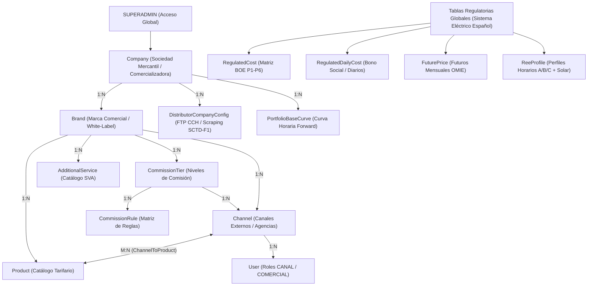
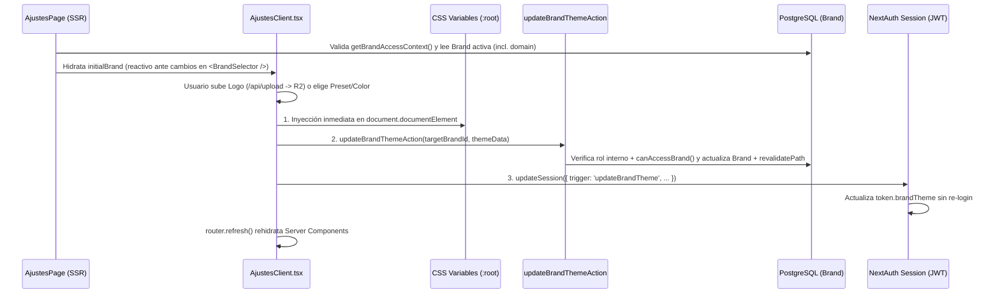

# Guía Integral de Configuración del ERP (`SP Energía`)

> **Documento Técnico y Funcional de Referencia**  
> Cubre en detalle la arquitectura multi-tenant, el sistema de permisos (RBAC), los modelos de datos Prisma, las rutas Frontend/API/Server Actions, la lógica de negocio y el impacto en los motores de cálculo (**Cotizador `/pricing`**, **Facturación Interna `InternalBillingEngine`** y **Liquidación de Comisiones `CommissionEngine`**) de todos los módulos del bloque **CONFIGURACIÓN** del ERP, así como sus entidades base asociadas en **Área Personal** y **Operaciones**.

---

## Índice

1. [Arquitectura Global de Configuración y Multi-Tenancy](#1-arquitectura-global-de-configuración-y-multi-tenancy)
   - 1.1 Jerarquía de Entidades (`Company` → `Brand` → `Channel` → `User`)
   - 1.2 Navegación Lateral (`Sidebar.tsx`) y Matriz de Visibilidad por Rol
   - 1.3 Selector de Marca Activa (`<BrandSelector />`), Cookies de Contexto y Resolución Server-Side
   - 1.4 Configuración Base Relacionada fuera del Acordeón (`Comercializadoras`, `Marcas`, `Distribuidoras`)
2. [Módulo 1: Usuarios y Control de Accesos (`/usuarios`)](#2-módulo-1-usuarios-y-control-de-accesos-usuarios)
3. [Módulo 2: Catálogo de Productos (`/productos` y `/productos/[id]`)](#3-módulo-2-catálogo-de-productos-productos-y-productosid)
4. [Módulo 3: Servicios Adicionales — SVA (`/servicios`)](#4-módulo-3-servicios-adicionales--sva-servicios)
5. [Módulo 4: Canales Comerciales (`/canales`)](#5-módulo-4-canales-comerciales-canales)
6. [Módulo 5: Configuración de Comisiones (`/comisiones-config`)](#6-módulo-5-configuración-de-comisiones-comisiones-config)
7. [Módulo 6: Ajustes Generales y Motor White-Label (`/ajustes`)](#7-módulo-6-ajustes-generales-y-motor-white-label-ajustes)
8. [Módulo 7: Costes Regulados BOE y Precios de Futuros (`/ajustes/costes-regulados`)](#8-módulo-7-costes-regulados-boe-y-precios-de-futuros-ajustescostes-regulados)
9. [Módulo 8: Perfiles Iniciales de Consumo REE (`/ajustes/perfiles-ree`)](#9-módulo-8-perfiles-iniciales-de-consumo-ree-ajustesperfiles-ree)
10. [Flujo Recomendado de Puesta en Marcha (Onboarding de Nueva Comercializadora/Marca)](#10-flujo-recomendado-de-puesta-en-marcha-onboarding-de-nueva-comercializadoramarca)
11. [Resumen de Garantías Técnicas y Reglas de Integridad en Configuración](#11-resumen-de-garantías-técnicas-y-reglas-de-integridad-en-configuración)

---

## 1. Arquitectura Global de Configuración y Multi-Tenancy

### 1.1 Jerarquía de Entidades (`Company` → `Brand` → `Channel` → `User`)

El ERP opera bajo una arquitectura **Multi-Sociedad (`Company`)** y **Multi-Marca Blanca (`Brand`)** sobre una única instancia de PostgreSQL gobernada por Prisma (`prisma/schema.prisma`):

**Distinción clave de alcance (Scope) en Configuración:**
- **Entidades aisladas por Marca (`brandId`)**: `Product`, `AdditionalService`, `Channel`, `CommissionTier` (+ `CommissionRule`) y los parámetros visuales de `Brand` en `/ajustes`. Cambiar de marca en el selector superior cambia inmediatamente el catálogo y las reglas que se visualizan y editan.
- **Entidades aisladas por Sociedad (`companyId`)**: `Company` (`/comercializadoras`), credenciales de distribuidoras `DistributorCompanyConfig` (`/distribuidoras`) y curvas `PortfolioBaseCurve`.
- **Entidades globales del sistema eléctrico nacional (sin `brandId` ni `companyId`)**: `RegulatedCost`, `RegulatedDailyCost`, `FuturePrice` (`/ajustes/costes-regulados`) y `ReeProfile` (`/ajustes/perfiles-ree`), ya que los peajes CNMC, cargos TED, futuros OMIE y coeficientes horarios de Red Eléctrica son únicos para todo el territorio peninsular/nacional.
- **Entidad transversal con alcance delegado (`User`)**: Un mismo usuario (`COMPANYADMIN`, `BACKOFFICE` o `COMERCIAL` directo) puede tener acceso simultáneo a múltiples sociedades (`UserCompanies`) y múltiples marcas (`UserBrands`).

---

### 1.2 Navegación Lateral (`Sidebar.tsx`) y Matriz de Visibilidad por Rol

El grupo desplegable **`CONFIGURACIÓN`** se define en `src/components/Sidebar.tsx` (líneas 174–186). A nivel de contenedor exige pertenecer a `['SUPERADMIN', 'COMPANYADMIN', 'BACKOFFICE']` (por lo que `CANAL`, `COMERCIAL` y `CLIENT` nunca ven el bloque `Configuración` en el menú lateral, aunque `CANAL` y `COMERCIAL` sí disponen de un acceso de solo lectura a `/productos` dentro del grupo `CRM Ventas`).

| Opción en Sidebar | Ruta (`href`) | Visibilidad Sidebar | Acceso Lectura (SSR / API) | Acceso Escritura (Mutaciones) | Ámbito de Datos |
| :--- | :--- | :--- | :--- | :--- | :--- |
| **Usuarios** | `/usuarios` | `SUPERADMIN`, `COMPANYADMIN` | `SUPERADMIN`, `COMPANYADMIN` | `SUPERADMIN`, `COMPANYADMIN` | Multi-Sociedad / Multi-Marca acotada al caller |
| **Productos** | `/productos` | `SUPERADMIN`, `COMPANYADMIN`, `BACKOFFICE` *(+ `CRM Ventas` para `CANAL`/`COMERCIAL`)* | Internos, `CANAL`/`COMERCIAL` (sanitizado) + API Key M2M | `SUPERADMIN`, `COMPANYADMIN`, `BACKOFFICE` | Por Marca activa (`active-brand`) |
| **Servicios Adic.** | `/servicios` | `SUPERADMIN`, `COMPANYADMIN`, `BACKOFFICE` | `SUPERADMIN`, `COMPANYADMIN`, `BACKOFFICE` *(+ `GET` API CRM sin `CLIENT`)* | `SUPERADMIN`, `COMPANYADMIN`, `BACKOFFICE` | Por Marca activa (`active-brand`) |
| **Canales** | `/canales` | `SUPERADMIN`, `COMPANYADMIN`, `BACKOFFICE` | `SUPERADMIN`, `COMPANYADMIN`, `BACKOFFICE` *(modo lectura en `BACKOFFICE`)* | `SUPERADMIN`, `COMPANYADMIN` | Por Marca activa (`active-brand`) |
| **Comisiones** | `/comisiones-config` | `SUPERADMIN`, `COMPANYADMIN` | `SUPERADMIN`, `COMPANYADMIN` | `SUPERADMIN`, `COMPANYADMIN` | Por Marca activa (`active-brand`) |
| **Ajustes Generales** | `/ajustes` | `SUPERADMIN`, `COMPANYADMIN`, `BACKOFFICE` | `SUPERADMIN`, `COMPANYADMIN`, `BACKOFFICE` (SSR guard) | `SUPERADMIN`, `COMPANYADMIN`, `BACKOFFICE` (marca autorizada) | Por Marca activa (`active-brand`) |
| **Costes Regulados (BOE)** | `/ajustes/costes-regulados` | `SUPERADMIN`, `COMPANYADMIN`, `BACKOFFICE` | `SUPERADMIN`, `COMPANYADMIN`, `BACKOFFICE` (SSR + API guard) | `SUPERADMIN`, `COMPANYADMIN`, `BACKOFFICE` | Global (Sistema Eléctrico) |
| **Perfiles REE (CSV)** | `/ajustes/perfiles-ree` | `SUPERADMIN`, `COMPANYADMIN`, `BACKOFFICE` | `SUPERADMIN`, `COMPANYADMIN`, `BACKOFFICE` | `SUPERADMIN`, `COMPANYADMIN`, `BACKOFFICE` | Global (Sistema Eléctrico) |

> **Detalle de coincidencia exacta de ruta en `Sidebar.tsx` (línea 303):**  
> A diferencia del resto de elementos del menú (que marcan activo `pathname === item.href || pathname.startsWith(item.href + '/')`), la entrada `/ajustes` fuerza coincidencia exacta (`item.href !== '/ajustes'`) para evitar que al entrar en `/ajustes/costes-regulados` o `/ajustes/perfiles-ree` quede iluminado simultáneamente `Ajustes Generales`.

---

### 1.3 Selector de Marca Activa (`<BrandSelector />`), Cookies de Contexto y Resolución Server-Side

1. **Carga en el Layout Autenticado (`src/app/(app)/layout.tsx`)**:
   - En cada petición SSR, el layout ejecuta `auth()` y consulta en caliente el registro `User` en PostgreSQL (`isActive`, `brand`, `assignedBrands`, `companies` con sus `brands`).
   - **Bloqueo instantáneo (`<BlockedSessionScreen />`)**: Si `!dbUser || dbUser.isActive === false`, el layout intercepta el renderizado antes de montar el `Sidebar` o los `children`, impidiendo operar aunque el token JWT aún no haya expirado.
   - Construye la lista deduplicada `allowedBrands`:
     - Para `SUPERADMIN`: **todas** las marcas de la tabla `Brand`.
     - Para el resto: unión de marca primaria (`brandId`) + marcas asignadas (`assignedBrands`) + todas las marcas hijas de sus sociedades (`companies.brands`).
2. **Conmutación de Marca (`src/components/BrandSelector.tsx` + `src/app/actions/brandActions.ts`)**:
   - Si el usuario tiene más de una marca en `allowedBrands`, la parte superior del `Sidebar` muestra `<BrandSelector />`.
   - Al elegir otra marca, se invoca la Server Action `setBrandCookie(brandId)` que escribe la cookie HTTP `active-brand` (`path: '/'`, `maxAge: 30 días`, `sameSite: 'lax'`), actualiza al vuelo los colores CSS mediante `BrandThemeContext` y ejecuta `router.refresh()` para recargar todos los Server Components con la nueva marca.
3. **Contexto Unificado Multi-Marca (`getBrandAccessContext` en `src/lib/permissions.ts`)**:
   - Exporta en servidor `{ userId, email, role, channelId, activeBrandId, allAuthorizedBrandIds, canAccessBrand(brandId) }` validando en vivo `user.isActive !== false`.
   - `allAuthorizedBrandIds` unifica automáticamente la marca primaria (`brandId`), `assignedBrands` y todas las marcas hijas de `companies`, impidiendo falsos rechazos o fugas entre marcas en los endpoints REST y Server Actions de Configuración (`/api/products`, `/api/channels`, `/api/settings/*`, `brandThemeActions`, `reeProfileActions`).
4. **Resolución de Sociedad Activa (`src/lib/companyContext.ts`)**:
   - La función `resolveActiveCompanyId(session)` lee primero la cookie `active-brand`, comprueba que el usuario tenga permiso sobre dicha marca y devuelve su `brand.companyId` (con fallback a la cookie `active-company` y finalmente a `session.user.companyId`). Así, herramientas como `/pricing` o `/distribuidoras` operan siempre sobre la comercializadora matriz de la marca seleccionada.

---

### 1.4 Configuración Base Relacionada fuera del Acordeón (`Comercializadoras`, `Marcas`, `Distribuidoras`)

Aunque en el `Sidebar` se ubican en **Área Personal** y **Operaciones**, estas tres pantallas constituyen los cimientos sobre los que se apoyan las 8 páginas de **Configuración**:

1. **Comercializadoras (`/comercializadoras` — `ComercializadorasClient.tsx` + `PUT /api/companies/[id]`)**:
   - Restringida a `SUPERADMIN` y `COMPANYADMIN`.
   - Configura los identificadores regulatorios y mercantiles de cada `Company`: `cif`, `cie`, `address`, `registroMercantil` (texto registral impreso en el pie vertical izquierdo del PDF de factura), códigos de mercado (`codigoRee`, `codigoAcer`, `unidadOfertaOmie`, `remit`, `codigoSujetoMercado`, `ordenCnmc` tipo `R2-xxx`), `residenciaCanarias` (activa IGIC 0%/3%/7% en lugar de IVA), flags operativos (`exportableOdoo`, `empresaVisible`, `emisionFacturasCliente`, `altaAutomaticaSips`) y fechas ISM.
   - **Etiquetado Energético CNMC (`etiquetaCnmc` — `src/lib/cnmcLabelConfig.ts`)**: Editor completo según Circular 2/2021 CNMC con escalas `A–G` de Emisiones de $\text{CO}_2$ (`g/kWh`) y Residuos Radiactivos (`µg/kWh`), acreditación GdO 100% Renovable (que gobierna el parámetro oficial `verde=1/0` del código QR comparador CNMC en las facturas), botón rápido *"Aplicar Preset 100% Renovable GdO (A / 0)"* y tabla de las 7 tecnologías de origen validando que `% Comercializadora` y `% Mix Nacional` sumen `100% ± 0,5%`.
2. **Marcas (`/marcas` — `MarcasClient.tsx` + `PUT /api/brands/[id]`)**:
   - Restringida a `SUPERADMIN`, `COMPANYADMIN` y `BACKOFFICE`.
   - Complementa a `/ajustes` permitiendo editar los parámetros operativos y documentales de cada `Brand`: `codigoMarca`, `address`, `email`, `supportEmail` (At. Cliente / Facturación), `phone`, `whatsappPhone`, `facturaElectrica` (remitente), `clave`, `enviosPorHora`, flags (`marcaVisible`, `gestionTickets`, `envioPromocion`, `envioCliente`, `envioCorreo`), plantillas (`mensaje`, `textoPromocional`), `manual` (URL condiciones), `penalizacion` (%), **doble logotipo** (`logoUrl` pequeño para panel + `invoiceLogoUrl` horizontal completo para PDFs de facturas e emails) y hasta **3 cuentas bancarias IBAN de transferencia** (`bankName1..3`, `bankIban1..3`).
3. **Datos Distribuidora (`/distribuidoras` — `DistribuidorasClient.tsx` + `/api/distributors`)**:
   - Configura `Distributor` y su tabla pivote `DistributorCompanyConfig` (`@@unique([distributorId, companyId])`), almacenando credenciales independientes por cada comercializadora tanto para **FTP/SFTP de curvas CCH** (`ftpHost`, `ftpPort`, `ftpUser`, `ftpPassword`, `ftpTargetPath`, `ftpActive`) como para **Web Scraping de portales SCTD/F1 XML** (`webUser`, `webPassword`, `webScriptPath`, `webScrapingActive`), soportando concentradoras (ej. CIDE, ASEME) y monitorizando la antigüedad de sincronización (`> 12h` ámbar, `> 36h` rojo).

---

## 2. Módulo 1: Usuarios y Control de Accesos (`/usuarios`)

### 2.1 Propósito Funcional
Gestiona el ciclo de vida completo de todas las cuentas de acceso al ERP y sus portales asociados: equipo interno (`SUPERADMIN`, `COMPANYADMIN`, `BACKOFFICE`), red de ventas externa (`CANAL`, `COMERCIAL`) y clientes finales con acceso al Área de Cliente (`CLIENT`).

### 2.2 Archivos Involucrados
- **Página SSR**: `src/app/(app)/usuarios/page.tsx`
- **Cliente Principal (Tabla, Pestañas y Filtros)**: `src/app/(app)/usuarios/UsersClient.tsx`
- **Modal de Creación/Edición**: `src/app/(app)/usuarios/UserModal.tsx`
- **Motor de Alcance y Seguridad Delegada**: `src/lib/userManagementScope.ts`
- **Helpers RBAC Globales**: `src/lib/permissions.ts`, `src/auth.ts`, `src/auth.config.ts`
- **Endpoints REST**:
  - `GET / POST` → `src/app/api/users/route.ts`
  - `GET / PUT` → `src/app/api/users/[id]/route.ts`

### 2.3 Modelo de Datos (`User` en `prisma/schema.prisma`)

| Campo / Relación | Tipo | Descripción y Comportamiento |
| :--- | :--- | :--- |
| `id` | `String @id @default(cuid())` | Identificador único interno. |
| `codigo` | `String? @unique` | Código interno de agente/operador (se limpia a `null` si el rol es `CLIENT`). |
| `email` | `String @unique` | Login único normalizado siempre a minúsculas (`.trim().toLowerCase()`). |
| `password` | `String` | Hash `bcryptjs` (10 rondas de salt). Jamás se devuelve al cliente (`omit: { password: true }`). |
| `role` | `Role` | Enum: `SUPERADMIN`, `COMPANYADMIN`, `BACKOFFICE`, `CANAL`, `COMERCIAL`, `CLIENT`. |
| `isActive` | `Boolean @default(true)` | Interruptor maestro de acceso en caliente (`false` bloquea login y sesiones vivas). |
| `brandId` | `String` | FK obligatoria a la `Brand` principal/por defecto del usuario. |
| `companyId` | `String?` | FK opcional a la `Company` principal del usuario. |
| `assignedBrands` | `Brand[] ("UserBrands")` | Relación M:N de marcas permitidas (`BACKOFFICE`, `COMERCIAL` directo, etc.). |
| `companies` | `Company[] ("UserCompanies")` | Relación M:N de sociedades administradas (clave para `COMPANYADMIN`). |
| `channelId` | `String?` | FK al `Channel` comercial (obligatoria en `CANAL`, opcional en `COMERCIAL`). |
| `isChannelSupervisor` | `Boolean @default(false)` | Si es `true` en un `COMERCIAL` adscrito a canal, audita toda la cartera del canal igual que el rol `CANAL`. |
| `commissionPct` | `Float?` | % de reparto de comisión informativa/interna del agente comercial. |
| `dni`, `phone` | `String?` | Datos identificativos de contacto. |
| `defaultSource` | `String @default("Directo")` | Origen por defecto en CRM (definido en esquema Prisma, no expuesto en `UserModal`). |
| `allowedAutoTariffs` | `String[] @default(["2.0TD"])` | Tarifas habilitadas para contratación automática (en esquema Prisma, no expuesto en `UserModal`). |

---

### 2.4 Arquitectura de Alcance Delegado (`getUserManagementScope`)

Definida en `src/lib/userManagementScope.ts`, esta función se ejecuta en el servidor tanto al cargar `/usuarios` como en cada llamada a `/api/users` y `/api/users/[id]`:

1. **Verificación en caliente**: Consulta el usuario autenticado en BD y rechaza inmediatamente si `!caller || caller.isActive === false` o si su rol no es `SUPERADMIN` ni `COMPANYADMIN`.
2. **Cálculo de perímetro para `COMPANYADMIN`**:
   - `allowedCompanyIds` = IDs de `caller.companies` + `caller.companyId`.
   - `allowedBrandIds` = todas las marcas hijas de `allowedCompanyIds` + `caller.assignedBrands` + `caller.brandId`.
   - `assignableRoles` = `['COMPANYADMIN', 'BACKOFFICE', 'CANAL', 'COMERCIAL', 'CLIENT']` (**nunca** `SUPERADMIN`).
3. **Invisibilidad y Sanitización Transversal**:
   - Un `COMPANYADMIN` solo recibe usuarios vinculados a sus `allowedCompanyIds` o `allowedBrandIds`, excluyendo siempre cuentas `role: 'SUPERADMIN'`.
   - **Sanitización SSR (`usuarios/page.tsx`, líneas 57–83)**: Si un usuario es **compartido** entre dos comercializadoras y lo visualiza el `COMPANYADMIN` de una de ellas, el servidor filtra los arrays `companies`, `assignedBrands` y `channel` antes de serializar las props a React para no filtrar nombres ni estructuras de sociedades ajenas.

---

### 2.5 Interfaz de Usuario (`UsersClient.tsx` y `UserModal.tsx`)

#### A) Pestañas Superiores y Filtros (`UsersClient.tsx`)
- **3 Pestañas con contadores en vivo**:
  1. `Equipo y Red Comercial` (`STAFF`: todos los roles excepto `CLIENT`).
  2. `Clientes Portal` (`CLIENTS`: únicamente `role === 'CLIENT'`).
  3. `Todos` (`ALL`).
- **Filtros combinables**:
  - Búsqueda libre por nombre, email, código, DNI o nombre de canal.
  - Selector de **Rol** dinámico (`availableRoles` recibe `scope.assignableRoles`, ocultando `SUPERADMIN` a un `COMPANYADMIN` conforme a la Regla 208).
  - Selector de **Marca** y selector de **Canal** (`DIRECT_ONLY` permite filtrar agentes directos sin canal).
  - Selector de **Estado Efectivo** (`ACTIVE` vs `BLOCKED`): Evalúa la función `hasEffectiveAccess(u)`:
    - Devuelve `false` ("Sin acceso / Revocado") si `u.isActive === false`, **o** si siendo `COMERCIAL` sin `channelId` se le han retirado todas sus marcas (`assignedBrands.length === 0`).
- **Paginación**: `PAGE_SIZE = 100` registros por página.

#### B) Formulario Adaptativo por Rol (`UserModal.tsx`)
El modal adapta dinámicamente sus bloques según el rol elegido:

| Rol Seleccionado | Asignación Organizativa Requerida en Modal y Backend | Herencia Automática de Marca / Sociedad |
| :--- | :--- | :--- |
| **`SUPERADMIN`** | Solo seleccionable por otro `SUPERADMIN`. Selector de marca principal por defecto. | Acceso total automático a todas las sociedades y marcas del ERP. |
| **`COMPANYADMIN`** | Checklist obligatorio de **Sociedades Administradas** (`assignedCompanyIds >= 1`). | Hereda acceso automático a **todas las marcas actuales y futuras** de esas sociedades (`auth.ts` y `permissions.ts`). |
| **`BACKOFFICE`** | Checklist obligatorio de **Marcas Asignadas** (`assignedBrandIds >= 1`) agrupadas visualmente por sociedad matriz. | Opera únicamente en las marcas marcadas; su `brandId` primario se sincroniza a la primera marca seleccionada si no pertenecía al conjunto. |
| **`CANAL`** | Selector obligatorio de **Canal Comercial** (`channelId`). | Hereda automáticamente `[channel.brandId]` y `[channel.brand.companyId]`. Ve todos los leads/contratos/comisiones de su canal. |
| **`COMERCIAL` (con Canal)** | Selector de **Canal Comercial** (`channelId`) + toggle **`isChannelSupervisor`** + `% Comisión`. | Hereda la marca y sociedad del canal. Si `isChannelSupervisor = false`, solo ve sus propios contratos; si es `true`, supervisa todo el canal. |
| **`COMERCIAL` (Directo / Propio)** | Sin canal (`channelId = ""`) + Checklist de **Marcas Asignadas** (`assignedBrandIds`). | En creación (`POST`) exige al menos 1 marca; en edición (`PUT`) **se permite dejar 0 marcas** para revocarle el acceso comercial sin borrar su histórico. |
| **`CLIENT`** | Selector único de **Marca del Portal de Cliente** (`brandId`). | Se limpia `codigo = null`, sin sociedades, sin canal ni marcas secundarias. Solo accede a `/mi-energia`. |

---

### 2.6 Protecciones Críticas de Seguridad en Backend (`/api/users` y `/api/users/[id]`)

1. **Blindaje del Superadmin Raíz (`ROOT_SUPERADMIN_EMAIL = 'fjponferrada@sp-energia.com'`)**:
   - En `UserModal.tsx` el campo `email` aparece bloqueado (`disabled`).
   - En `PUT /api/users/[id]`, cualquier intento de desactivar (`isActive === false`) o degradar el rol (`role !== 'SUPERADMIN'`) devuelve `403 Forbidden`.
2. **Anti-Autobloqueo (`existingUser.id === scope.callerId`)**:
   - Ningún administrador puede desactivar su propia cuenta (`isActive = false`) ni rebajar su propio rol (`400 Bad Request`), evitando quedarse fuera del sistema por accidente.
3. **Preservación de Relaciones Externas en Usuarios Compartidos (`PUT /api/users/[id]`, líneas 92–112)**:
   - Cuando un `COMPANYADMIN` edita un usuario que también trabaja con otra sociedad del grupo fuera del alcance del editor, el endpoint calcula `preservedExternalBrandIds` y `preservedExternalCompanyIds` (y respeta el `channelId` / `isChannelSupervisor` externo) fusionándolos con los nuevos IDs antes del `set` en Prisma. De este modo, revocar o cambiar marcas de la Sociedad A **jamás destruye** los accesos que el usuario tenía en la Sociedad B.
4. **Política de Contraseñas**:
   - Mínimo `8` caracteres en creación y en cambio opcional de contraseña durante edición (`bcrypt.hash(rawPassword, 10)`).
   - No existe endpoint `DELETE` de usuarios: las bajas operativas se ejecutan siempre mediante desactivación (`isActive = false`) o retirada de marcas para preservar la trazabilidad histórica en `Lead`, `Contract` y liquidaciones.

---

## 3. Módulo 2: Catálogo de Productos (`/productos` y `/productos/[id]`)

### 3.1 Propósito Funcional
Administra el catálogo tarifario de electricidad por marca comercial (tarifas fijas, indexadas pass-through, indexadas personalizadas, con o sin autoconsumo y Bolsillo Solar), definiendo precios de potencia, precios de energía, fees, costes de desvíos y márgenes objetivos que alimentan el CRM, las integraciones externas vía API y el motor de facturación y comisiones.

### 3.2 Archivos Involucrados
- **Listado SSR**: `src/app/(app)/productos/page.tsx`
- **Cliente de Catálogo**: `src/app/(app)/productos/ProductosClient.tsx`
- **Modal de Producto (6 Pestañas)**: `src/app/(app)/productos/ProductModal.tsx`
- **Vista Detalle Individual (`/productos/[id]`)**: `src/app/(app)/productos/[id]/page.tsx` y `ProductDetailClient.tsx`
- **Server Action de Filtrado Autorizado**: `src/app/actions/productActions.ts` (`getAuthorizedProductsWhereClause`, `getProductsPageData`)
- **Endpoints REST**:
  - `GET / POST` → `src/app/api/products/route.ts`
  - `PUT / DELETE` → `src/app/api/products/[id]/route.ts`
  - Cotizador asociado → `POST /api/pricing/route.ts` y `/pricing`

### 3.3 Modelo de Datos (`Product` en `prisma/schema.prisma`)

| Bloque | Campos en `Product` | Unidad / Formato | Descripción |
| :--- | :--- | :--- | :--- |
| **Identidad y Alcance** | `id`, `brandId`, `name`, `airtableData` | CUID / String / Json? | Vinculado siempre a una `Brand` (`brandId`). `airtableData` conserva metadatos de migración y se purga para roles externos/API. |
| **Clasificación Tarifaria** | `type`, `pricingModel`, `tariff`, `permanenceMonths` | String / Int | `pricingModel`: `'FIXED'` o `'INDEXED'`. `tariff`: `'2.0TD'`, `'3.0TD'`, `'3.0TDVE'`, `'6.1TD'`, `'6.1TDVE'`, `'6.2TD'`, `'6.3TD'`, `'6.4TD'`. |
| **Visibilidad CRM y Personalización** | `isAvailableCrm`, `isCustomizable`, `channels` | Bool / M:N | `isAvailableCrm` controla si el producto está publicado en CRM; `isCustomizable` habilita a comerciales/canales ajustar Fee e `IP1..IP6` en el Lead; `channels` (`ChannelToProduct`) restringe qué canales pueden venderlo. |
| **Precios Potencia Cliente** | `p1p` .. `p6p` | `€/kW/año` (Float) | Precios anuales ofertados al cliente por periodo (se convierten a `€/kW/día` en contrato/factura dividiendo por 365 o 366 según motor). |
| **Precios Energía Cliente** | `p1e` .. `p6e` | `€/kWh` (Float) | Precios fijos de energía ofertados al cliente (hasta 6 decimales). |
| **Autoconsumo y Solar** | `hasSelfConsumption`, `selfConsumptionType`, `pexc`, `feeExcedentes`, `cgBolsilloSolar` | Bool / String / Float | `pexc` (`€/MWh` o `€/kWh` según modalidad excedentes), `feeExcedentes` (`€/MWh`), `cgBolsilloSolar` (`€/mes` coste gestión hucha solar). |
| **Indexado y Comisiones** | `commissionType`, `fee`, `deviationCost`, `powerTiersCommission` | String / `€/MWh` / Json? | `commissionType`: `'MARGIN_PERCENTAGE'` o `'POWER_TIERS'`. `fee`: margen indexado (`€/MWh`). `deviationCost`: coste operativo de desvíos (`€/MWh`). |
| **Márgenes Internos Mayoristas** | `marginFC`, `ip1` .. `ip6` | `€/MWh` y `€/kW/año` | **Confidenciales**: margen comercial de energía (`marginFC`) y sobreprecio comercial de potencia por periodo (`ip1..ip6`) persistidos en `POST/PUT` para calcular la comisión del canal. |

---

### 3.4 Lógica de Visibilidad Dual (Sesión ERP vs API Externa M2M)

#### 1. En el ERP (`getAuthorizedProductsWhereClause` en `src/app/actions/productActions.ts`)
- Resuelve la marca activa leyendo la cookie `active-brand` (validando pertenencia en las marcas autorizadas del usuario salvo `SUPERADMIN`; si no, usa `user.brandId`).
- Bloquea en SSR (`/productos` y `/productos/[id]`) el acceso de cuentas `CLIENT` o desactivadas.
- Si el usuario tiene rol `CANAL` o `COMERCIAL`:
  - Fuerza `isAvailableCrm: true`.
  - Si el usuario pertenece a un canal (`user.channelId`), añade además `channels: { some: { id: user.channelId } }`, mostrando exclusivamente los productos asignados a su canal.
  - Purga del árbol RSC `marginFC`, `ip1..ip6` y `airtableData` antes de hidratar el cliente.

#### 2. En la API REST (`GET /api/products/route.ts`)
Soporta **doble mecanismo de autenticación**:
- **Sesión NextAuth estándar** validada con `getBrandAccessContext()` (rechazando `CLIENT` y cuentas inactivas con `403`).
- **API Key M2M (`Authorization: Bearer <AED_API_KEY>`)** para portales web o comparadores externos:
  - Lee opcionalmente la cabecera `X-Brand-Id`.
  - Busca automáticamente en BD un usuario con `role: 'CANAL'` cuyo nombre contenga `"Web"` (en esa marca) para heredar la lista blanca exacta de productos del Canal Web (`isAvailableCrm: true` + productos conectados a dicho canal).
- **Sanitización de Márgenes Confidenciales**: Siempre que la petición provenga de `isApiKey` o de un rol comercial externo (`CANAL` / `COMERCIAL`), el servidor elimina del JSON `marginFC`, `ip1..ip6` y `airtableData` antes de responder.

---

### 3.5 Interfaz de Usuario (`ProductosClient.tsx`, `ProductModal.tsx`, `ProductDetailClient.tsx`)

- **Permiso de Edición (`canEdit`)**: Solo `['SUPERADMIN', 'COMPANYADMIN', 'BACKOFFICE']` ven el botón **`+ Nuevo Producto`** y pueden editar o eliminar (`DELETE /api/products/[id]`, que bloquea el borrado si el producto ya tiene contratos vinculados y limpia transaccionalmente `channels` y `commissionRules` en caso contrario). Para `CANAL` y `COMERCIAL`, el clic abre el modal en modo **`Ficha de Producto`** (`<fieldset disabled={!canEdit}>`), **oculta las pestañas `Comisiones / Index` y `Márgenes (Interno)`**, y tanto el payload RSC de `/productos` y `/productos/[id]` como `GET /api/products` purgan del lado servidor `marginFC`, `ip1..ip6` y `airtableData`.
- **Filtros de Catálogo en `ProductosClient.tsx`**: Búsqueda por nombre/tipo, filtro por las **8 tarifas ATR** (`2.0TD`, `3.0TD`, `3.0TDVE`, `6.1TD`, `6.1TDVE`, `6.2TD`, `6.3TD`, `6.4TD`), filtro por **Modalidad** (`FIXED` vs `INDEXED`) y filtro por **Estado CRM** (`Disponibles en CRM` vs `Ocultos`).
- **Las 6 Pestañas de `ProductModal.tsx`**:
  1. **General**: Nombre, Tarifa (8 tarifas ATR), Modalidad (`FIXED` / `INDEXED`), Tipo descriptivo, Permanencia (meses), checks `Disponible en CRM` y `Producto Personalizable (Márgenes editables por Canal)`.
  2. **Potencia**: Inputs `P1P..P6P` (`€/kW/año`). Si `tariff === '2.0TD'`, oculta automáticamente `P3P..P6P` (ya que en 2.0TD solo existen dos periodos de potencia contratada P1 y P2).
  3. **Energía**: Inputs `P1E..P6E` (`€/kWh`). Si `tariff === '2.0TD'`, oculta `P4E..P6E` (2.0TD tiene 3 periodos de energía P1, P2 y P3).
  4. **Autoconsumo**: Toggle `¿Aplica Autoconsumo?`; si se activa, despliega Modalidad, `PExc`, `Fee Excedentes` y `Coste Gestión Bolsillo Solar (€/mes)`.
  5. **Comisiones / Index** *(solo `canEdit`)*: Modelo de comisión (`MARGIN_PERCENTAGE` vs `POWER_TIERS`), `Fee Energía (€/MWh)` y `Coste Desvío (€/MWh)`.
  6. **Márgenes (Interno)** *(solo `canEdit`)*: `marginFC (€/MWh)` e `IP1..IP6 (€/kW/año)`, persistidos en `POST /api/products` y `PUT /api/products/[id]`.
- **Creación Directa desde el Cotizador (`/pricing`)**: Tras calcular una propuesta de precios en `/pricing`, el botón **`Guardar como Producto`** abre `ProductModal` pre-rellenado con los precios ofertados `P1E..P6E` convertidos a `€/kWh`, tarifa, duración, coste de desvíos y `marginFC` para publicarlo directamente en el catálogo de la marca activa.
- **Vista `/productos/[id]` (`ProductDetailClient.tsx`)**: Protegida server-side con `getAuthorizedProductsWhereClause()` (validando marca y lista blanca de canal), mostrando bloques de potencia, energía, autoconsumo y parámetros operativos sin exponer márgenes internos.

### 3.6 Impacto en Motores Aguas Abajo (Snapshot Inmutable)
Al convertir un `Lead` en `Contract` (o al ejecutar `extractContractMarginSnapshots` en `src/lib/services/CommissionEngine.ts`), los valores de precios y márgenes del producto (`fee`, `marginFC`, `ip1..ip6`, `productTypeSnapshot`) se **congelan como snapshot en la tabla `Contract`**. Así, actualizar las tarifas de un `Product` en `/productos` para nuevas altas **nunca altera retroactivamente** ni los precios firmados ni las comisiones de contratos ya vigentes (Regla 35).

---

## 4. Módulo 3: Servicios Adicionales — SVA (`/servicios`)

### 4.1 Propósito Funcional
Gestiona el catálogo de **Servicios de Valor Añadido (SVA)** por marca comercial (mantenimiento eléctrico, urgencias, protección de pagos, asistencia, etc.) que pueden adjuntarse opcionalmente a cualquier oferta/contrato de suministro eléctrico y generar comisión recurrente o anualizada para la red comercial.

### 4.2 Archivos Involucrados
- **Página SSR**: `src/app/(app)/servicios/page.tsx`
- **Tabla e Interacciones Cliente**: `src/app/(app)/servicios/ServiciosClient.tsx`
- **Modal de Alta/Edición**: `src/app/(app)/servicios/ServicioModal.tsx`
- **Server Actions**: `src/app/actions/serviciosActions.ts` (`getServiciosPageData`, `createServicioAction`, `updateServicioAction`, `toggleServicioStatusAction`)
- **Endpoint REST (Consumo en Formularios CRM)**: `GET /api/additional-services` (`src/app/api/additional-services/route.ts`)

### 4.3 Modelo de Datos (`AdditionalService` en `prisma/schema.prisma`)

| Campo | Tipo | Descripción y Uso en Motores |
| :--- | :--- | :--- |
| `id` | `String @id @default(cuid())` | Identificador único del SVA. |
| `brandId` | `String` | Marca propietaria del servicio (`onDelete: Cascade`). |
| `name` | `String` | Nombre comercial impreso en contrato y factura. |
| `monthlyPrice` | `Float?` | **Cuota mensual comercial (`€/mes`, sin IVA)** mostrada al cliente y usada para anualizar el margen comisionable (`monthlyPrice * 12`). |
| `dailyPrice` | `Float?` | **Precio diario exacto (`€/día`, hasta 6 decimales)** utilizado para el prorrateo por días efectivos en facturación. |
| `durationMonths` | `Int @default(120)` | Vigencia del servicio en meses (por defecto `120` meses = 10 años). |
| `isCommissionable` | `Boolean @default(false)` | Si es `true`, el servicio aparece seleccionable en `/comisiones-config` y devenga comisión en `CommissionEngine`. |
| `isActive` | `Boolean @default(true)` | Controla si el servicio se ofrece en nuevas contrataciones (`GET /api/additional-services`). |

---

### 4.4 Funcionamiento, Permisos e Impacto en Facturación y Comisiones

1. **Seguridad y Multi-Marca (`serviciosActions.ts`)**:
   - Restringido en SSR y en las 3 Server Actions a `['SUPERADMIN', 'COMPANYADMIN', 'BACKOFFICE']` (`verifyAdminAccess()`).
   - Resuelve la marca objetivo leyendo la cookie `active-brand` (verificando pertenencia en `allowedBrands` salvo `SUPERADMIN`) con fallback a `session.user.brandId`.
   - En actualización y cambio de estado (`updateServicioAction`, `toggleServicioStatusAction`), verifica previamente que `existing.brandId === brandId` antes de escribir en BD (`revalidatePath('/servicios')`). Además, `ServiciosClient.tsx` sincroniza reactivamente su estado local (`useEffect`) cuando el usuario conmuta de marca en `<BrandSelector />`.
2. **Consumo en CRM (`GET /api/additional-services`)**:
   - Bloquea cuentas `CLIENT` o desactivadas (`403 Forbidden`) y devuelve únicamente los servicios con `isActive: true` de la marca activa para poblar los selectores de Leads y Contratos.
   - Al contratar, los servicios elegidos se guardan como snapshot JSON en `Contract.additionalServicesSnapshot` (incluyendo `id`, `name`, `monthlyPrice`, `dailyPrice`, `isCommissionable` y sus propias fechas de alta/baja independientes del suministro eléctrico).
3. **Impacto Fiscal y de Facturación (Reglas 172 y 175)**:
   - **Fiscalidad**: Los SVA están **exentos de Impuesto Eléctrico (IE)**, pero **sí tributan al IVA general (21%)** (o tipo indirecto aplicable).
   - **Prorrateo Temporal Independiente**: Un SVA puede activarse o darse de baja a mitad de un periodo de facturación eléctrica; el motor calcula el cargo diario solo por la intersección exacta `[max(inicioFactura, altaSVA), min(finFactura, bajaSVA)]`.
4. **Impacto en Comisiones (`CommissionEngine.ts`, líneas 408–430)**:
   - Si el SVA tiene `isCommissionable: true`, `matchBestServiceRule` busca en el nivel del canal la regla más específica vinculada a ese `service.id`.
   - Si la regla es `FIXED`, suma el importe fijo en euros; si es `PERCENTAGE`, aplica el porcentaje sobre el margen anualizado de **12 meses fijos** (`monthlyPrice * 12`, o `dailyPrice * (365 / 12) * 12`), con independencia de que `durationMonths` sea `120`.

---

## 5. Módulo 4: Canales Comerciales (`/canales`)

### 5.1 Propósito Funcional
Configura las agencias externas, corredurías, colaboradores y canales propios (`Channel`) de cada marca, definiendo su código único, su **Nivel de Comisión (`CommissionTier`)**, sus buzones departamentales de notificación, sus reglas operativas de contratación/renovación y el subconjunto de productos que tienen autorizado comercializar.

### 5.2 Archivos Involucrados
- **Página SSR y KPIs**: `src/app/(app)/canales/page.tsx`
- **Tabla y Tarjetas KPI**: `src/app/(app)/canales/CanalesClient.tsx`
- **Modal de Configuración de Canal**: `src/app/(app)/canales/ChannelModal.tsx`
- **Endpoints REST**:
  - `GET / POST` → `src/app/api/channels/route.ts`
  - `PUT` → `src/app/api/channels/[id]/route.ts`

### 5.3 Modelo de Datos (`Channel` en `prisma/schema.prisma`)

| Campo / Relación | Tipo | Descripción |
| :--- | :--- | :--- |
| `id` | `String @id @default(cuid())` | Identificador único interno del canal. |
| `name` | `String` | Nombre comercial de la agencia o canal. |
| `code` | `String @unique` | **Código único global** del canal (ej. `CH-042`). |
| `brandId` | `String` | FK a la `Brand` a la que pertenece el canal. |
| `commissionTierId` | `String?` | FK a `CommissionTier` (ej. *Bronce, Plata, Oro*). Determina qué matriz de reglas aplica `CommissionEngine` a todos los contratos del canal. |
| `fixedCommissionPct`, `variableCommissionPct` | `Float @default(0)` | Porcentajes base/referenciales del canal. |
| `supervisorEmail`, `adminEmail`, `managerEmail`, `supportEmail` | `String?` | Directorio de 4 emails departamentales (Responsable Comercial, Administración/Liquidaciones, Dirección/Gerencia y Soporte/Tramitación) usados en comunicaciones automáticas y envíos de liquidaciones. |
| `autoGenerateContract` | `Boolean @default(false)` | Permite al canal generar directamente el borrador/PDF de contrato desde el flujo de Leads sin validación previa de Backoffice. |
| `maxRenewalDays` | `Int @default(45)` | Antelación máxima (en días antes del vencimiento anual) con la que el canal puede presentar/tramitar una renovación de cartera. |
| `products` | `Product[] ("ChannelToProduct")` | Lista blanca M:N de productos que los usuarios de este canal pueden ver y ofertar. |
| `users` | `User[]` | Usuarios con rol `CANAL` o `COMERCIAL` adscritos al canal (de cuyo estado `isActive` se deriva el indicador operativo del canal en `/canales`). |

---

### 5.4 Lógica de Pantalla, KPIs y Asignación Bidireccional de Productos

1. **Cálculo Ligero de KPIs en SSR (`canales/page.tsx`)**:
   - Exige rol interno (`SUPERADMIN`, `COMPANYADMIN` o `BACKOFFICE`) y acota canales, niveles de comisión y productos disponibles a la marca activa (`active-brand`).
   - Optimiza la consulta de usuarios del canal mediante `_count: { select: { contracts: true } }` y `contracts: { where: { status: 'ACTIVO' }, select: { id: true } }` sin hidratar columnas JSON pesadas de contratos.
   - Deriva el estado operativo (`Activo` / `Sin usuarios activos`) a partir de los usuarios en activo del canal e identifica el **Contacto Principal** priorizando el supervisor (`isChannelSupervisor === true`).
   - Respeta `canEdit` (`SUPERADMIN` y `COMPANYADMIN`): `BACKOFFICE` accede a `/canales` y abre `ChannelModal` en modo **Ficha de Solo Lectura** (`Detalle`), evitando errores `403`.
2. **Estructura de `ChannelModal.tsx`**:
   - **Datos Identificativos y Nivel**: Nombre, Código único, y selector desplegable de **Nivel de Comisión (`commissionTierId`)** validado contra la misma marca.
   - **Directorio de Emails**: Los 4 buzones especializados (`supervisorEmail`, `adminEmail`, `managerEmail`, `supportEmail`).
   - **Reglas Operativas**: Ventana `Días Máx. Renovación` (`maxRenewalDays`) y check `Autogenerar Contrato desde Lead` (`autoGenerateContract`).
   - **Buscador y Asignador de Catálogo + Árbol Visual**:
     - Incluye buscador en tiempo real por nombre/tipo, filtro por las 8 tarifas ATR y acciones masivas **`+ Añadir visibles`** / **`Quitar todos`** para poblar la lista blanca `ChannelToProduct`.
     - Agrupa los productos asignados en 3 niveles: **Tarifa** (`2.0TD`..`6.4TD`, `3.0TDVE`, `6.1TDVE`), **Modalidad** (`Fijos` vs `Indexados` vía `pricingModel`) y **Autoconsumo** (`Sin Autoconsumo` vs `Con Autoconsumo ☀️`).
   - **Validación Multi-Marca en API (`POST /api/channels` y `PUT /api/channels/[id]`)**: Asigna `activeBrandId` al crear canales nuevos y comprueba en servidor que tanto `commissionTierId` como todos los `productIds` pertenezcan a la misma `Brand` del canal.

---

## 6. Módulo 5: Configuración de Comisiones (`/comisiones-config`)

### 6.1 Propósito Funcional
Define la arquitectura retributiva para los canales comerciales de cada marca mediante un sistema matricial de dos niveles: **Niveles de Comisión (`CommissionTier`)** y **Reglas de Comisión (`CommissionRule`)**, soportando tanto reparto porcentual sobre el margen bruto comercial (`% sobre Margen`) como importes fijos por punto de suministro (`Euros fijos €`), tramos de potencia contratada media y comisiones específicas sobre Servicios Adicionales (SVA).

### 6.2 Archivos Involucrados
- **Página SSR**: `src/app/(app)/comisiones-config/page.tsx`
- **Panel Maestro-Detalle**: `src/app/(app)/comisiones-config/ComisionesClient.tsx`
- **Modales**:
  - `src/app/(app)/comisiones-config/TierModal.tsx` (Crear / Editar / Duplicar Nivel)
  - `src/app/(app)/comisiones-config/RuleModal.tsx` (Crear / Editar / Duplicar Regla)
- **Helper de Marca Activa**: `getActiveBrand()` (`src/lib/permissions.ts`)
- **Endpoints REST**:
  - `GET / POST` → `src/app/api/commission-tiers/route.ts`
  - `PUT / DELETE` → `src/app/api/commission-tiers/[id]/route.ts`
  - `POST` → `src/app/api/commission-rules/route.ts`
  - `PUT / DELETE` → `src/app/api/commission-rules/[id]/route.ts`
- **Motor Consumidor**: `src/lib/services/CommissionEngine.ts`

### 6.3 Modelos de Datos (`CommissionTier` y `CommissionRule`)

#### A) `CommissionTier` (`@@unique([name, brandId])`)
Agrupador lógico por marca (ej. *Estándar, Plata, Oro, VIP*). Almacena `name`, `description`, `brandId`, los `channels` adheridos a dicho nivel y su colección de `rules`.

#### B) `CommissionRule`
Cada fila representa una condición de cálculo dentro de un `CommissionTier`:

| Campo | Tipo | Semántica Exacta |
| :--- | :--- | :--- |
| `id` | `String @id @default(cuid())` | Identificador único de la regla. |
| `tierId` | `String` | FK al `CommissionTier` padre (`onDelete: Cascade`). |
| `tariff` | `String?` | `null` = **Cualquier tarifa**; o una de las 8 tarifas ATR (`2.0TD`, `3.0TD`, `3.0TDVE`, `6.1TD`, `6.1TDVE`, `6.2TD`, `6.3TD`, `6.4TD`). |
| `productType` | `String?` | `null` = **Cualquier producto**; agrupaciones generales (`'Fijo'`, `'Indexado'`) o subtipos específicos (ej. `'Precio fijo único'`, `'Precio fijo por periodo'`, `'Precio indexado Pass-Through'`). |
| `products` | `Product[]` | Lista opcional M:N (`CommissionRuleToProduct`). Vacía = aplica a cualquier producto que cumpla tarifa/tipo; con elementos = aplica **exclusivamente** a esos productos. |
| `additionalServices` | `AdditionalService[]` | Lista opcional M:N (`AdditionalServiceToCommissionRule`). Solo muestra servicios de la marca con `isCommissionable: true`. |
| `powerMin`, `powerMax` | `Float?` | Rango opcional de **Potencia Media Contratada** en kW: $\text{Potencia Media} = \frac{P_1 + P_2}{2}$. Intervalo semiabierto **`[powerMin, powerMax)`** (`>= powerMin` y `< powerMax`). |
| `commissionType` | `String` | `'PERCENTAGE'` (*% sobre Margen*) o `'FIXED'` (*Importe Fijo en €*). |
| `value` | `Float` | Porcentaje (`0–100+`) o euros fijos (`€`) por contrato anual. |

---

### 6.4 Operaciones Avanzadas en UI y API

1. **Aislamiento Estricto de Seguridad y Sincronización de Marca**:
   - Tanto `Sidebar.tsx` como `comisiones-config/page.tsx` y los **4 endpoints REST** exigen rol `SUPERADMIN` o `COMPANYADMIN` (`BACKOFFICE`, `CANAL` y `COMERCIAL` tienen bloqueado el acceso).
   - Todos los datos se filtran por la marca activa resuelta en `getActiveBrand()` (`active-brand` cookie validada contra marcas autorizadas), y `ComisionesClient.tsx` refresca automáticamente `tiers` al conmutar `<BrandSelector />`.
2. **Clonación Profunda de Niveles (`copyFromId` en `POST /api/commission-tiers`)**:
   - Al pulsar el icono **Duplicar Nivel** en `ComisionesClient.tsx`, `TierModal` envía `copyFromId`. El backend crea el nuevo `CommissionTier` y clona automáticamente **todas sus `CommissionRule`**, reconectando las relaciones M:N `products` y `additionalServices` de cada regla en una sola operación.
3. **Borrado Transaccional Seguro (`DELETE /api/commission-tiers/[id]`)**:
   - Ejecuta `prisma.$transaction`:
     1. Elimina todas las `CommissionRule` del nivel.
     2. Desvincula limpiamente los canales que lo tuvieran asignado (`channel.updateMany({ where: { commissionTierId: id }, data: { commissionTierId: null } })`).
     3. Elimina el `CommissionTier` sin romper integridad referencial.
4. **Duplicado Rápido y Validación Multi-Marca de Reglas (`RuleModal.tsx` y `/api/commission-rules`)**:
   - Al cambiar `tariff` o `productType` en `RuleModal`, la selección previa de productos específicos se resetea automáticamente y la lista de productos se filtra en vivo evaluando `pricingModel` (`FIXED` / `INDEXED`) además de `type` (con botones *"Seleccionar todos"* / *"Desmarcar todos"*).
   - Tanto `POST /api/commission-rules` como `PUT /api/commission-rules/[id]` validan que `powerMin < powerMax` y filtran en base de datos `productIds` y `serviceIds` contra `tier.brandId` para impedir vínculos cruzados entre marcas.

---

### 6.5 Algoritmo de Resolución de Prioridades y Cálculo (`CommissionEngine.ts`)

Cuando un contrato se activa o liquida, `calculateAndSnapshotContractCommission` ejecuta el siguiente motor determinista:

#### 1. Puntuación de Especificidad (`matchBestCommissionRule`, líneas 172–242)
Dentro del `CommissionTier` asignado al canal del comercial, se descartan primero las reglas que son *exclusivamente* de SVA (`svcCount > 0 && prodCount === 0 && !tariff && !productType`), y se evalúa cada regla candidata sumando puntos de especificidad si cumple todas sus condiciones:
- **Producto específico incluido en `rule.products`**: **`+100 puntos`** (máxima prioridad absoluta).
- **`productType` exacto** (distinto del comodín `'Fijo'`/`'Indexado'`): **`+2 puntos`**.
- **`productType` genérico** (`'Fijo'` busca `.includes('fijo')`; `'Indexado'`/`'Index'` busca `.includes('indexado')`): **`+1 punto`**.
- **`tariff` coincidente**: **`+1 punto`**.
- **`powerMin` cumplido** ($\frac{P_1 + P_2}{2} \ge \text{powerMin}$): **`+1 punto`**.
- **`powerMax` cumplido** ($\frac{P_1 + P_2}{2} < \text{powerMax}$): **`+1 punto`**.
- Una regla comodín total (todo vacío) suma **`0 puntos`** y actúa como *fallback* universal del nivel. Gana siempre la regla válida con **mayor puntuación**.

#### 2. Fórmulas Matemáticas Anualizadas (Horizonte Fijo 12 Meses / 365 Días)
- **Si `commissionType === 'FIXED'`**:
  $$\text{Comisión Suministro} = \text{value (€)}$$
- **Si `commissionType === 'PERCENTAGE'`**:
  $$\text{Margen Energía} = \text{Consumo Anual (MWh)} \times \text{marginFC (€/MWh)}$$
  $$\text{Margen Potencia} = \sum_{i=1}^{6} \left( P_{i,\text{contratada}} \text{ (kW)} \times IP_i \text{ (€/kW/año)} \right)$$
  $$\text{Comisión Suministro} = (\text{Margen Energía} + \text{Margen Potencia}) \times \frac{\text{value}}{100}$$
- **Más Comisiones SVA (`matchBestServiceRule`, base `+50 puntos` por coincidir `serviceId`)**:
  - Se suman al total del contrato evaluando `Contract.additionalServicesSnapshot` sobre un horizonte fijo de 12 meses (`monthlyPrice * 12`), independientemente de la permanencia del cliente.
- **Ciclo de Vida Posterior en Liquidaciones**:
  - **Baja Rápida (*Quick Drop*, `isQuickDropChain`)**: Si el suministro cae antes del día 11 del mes siguiente a su activación, se anula tanto el devengo inicial como la decomisión (`0 €`).
  - **Decomisión Proporcional**: En bajas anticipadas posteriores (procesos CNMC `C1/C2/B1/B2/E1/E2/T1`), se recupera la fracción no consumida sobre 365 días. Las renovaciones (`tipo === 'R'` o tácitas) abren una cadena independiente de 365 días (`splitContractsIntoCommissionChains`).
  - **True-Up Industrial (`>= 3.0TD`, `summarizeChainInvoicesForTrueUp`)**: Concilia el consumo real facturado en `InternalInvoice` / `Invoice` frente al consumo estimado inicial.

---

## 7. Módulo 6: Ajustes Generales y Motor White-Label (`/ajustes`)

### 7.1 Propósito Funcional
Permite personalizar en tiempo real la identidad visual corporativa (**White-Label / Marca Blanca**) de la marca actualmente seleccionada: logotipo, nombre visible, dominio web propio para el portal/PWA y paleta completa de colores de la interfaz, con previsualización instantánea sin recargar el navegador.

### 7.2 Archivos Involucrados
- **Página SSR (Guard de Rol y Carga de Marca Activa)**: `src/app/(app)/ajustes/page.tsx`
- **Cliente Interactivo de Ajustes**: `src/app/(app)/ajustes/AjustesClient.tsx`
- **Server Action de Persistencia**: `src/app/actions/brandThemeActions.ts` (`updateBrandThemeAction`)
- **Contexto React de Tema Dinámico**: `src/context/BrandThemeContext.tsx` (`BrandThemeProvider`, `useBrandTheme`)
- **Sincronización JWT NextAuth**: `src/auth.config.ts` (`trigger === 'updateBrandTheme'`)
- **Manifiesto PWA Dinámico por Dominio**: `src/app/manifest.ts`
- **Subida de Activos a Nube (Cloudflare R2)**: `POST /api/upload`

---

### 7.3 Arquitectura del Motor de Temas en 3 Capas

1. **Protección SSR y Secciones del Menú Interno de `/ajustes`**:
   - `ajustes/page.tsx` bloquea server-side cualquier rol distinto de `SUPERADMIN`, `COMPANYADMIN` o `BACKOFFICE`, hidratando en `AjustesClient.tsx` todos los campos reales de la marca activa (sincronizados mediante `useEffect` al cambiar `<BrandSelector />`).
   - **`Marca & Identidad`**: 100% operativa.
   - **`Seguridad`**, **`Notificaciones`** e **`Integraciones`**: Identificadas en el menú lateral con badge **`Próx.`** como secciones reservadas para futuras ampliaciones.
2. **Parámetros Editables en `Marca & Identidad`**:
   - **Logo de la Marca**: Subida de fichero (`PNG, SVG, JPG, WEBP`, límite estricto de **`512 KB`** en cliente) enviada mediante `FormData` a `POST /api/upload` (`folder: 'logos'`), almacenada en **Cloudflare R2** y previsualizada al instante. También actualiza dinámicamente el `<link rel="icon">` del navegador.
   - **Nombre de la Marca (`brandName`)** y **Dominio Personalizado (`domain`)**: Ej. `clientes.mimarca.es` (normalizado en `updateBrandThemeAction` eliminando `http(s)://` y barras finales).
   - **6 Presets Corporativos Predefinidos**:
     - *SP Energía (Lima — Por defecto)*: Acento `#DEFF9A`, Fondo `#0B0F19`, Superficie `#111827`, Bordes `#1E2A3A`.
     - *Azul Corporativo* (`#60A5FA`), *Naranja Energía* (`#FB923C`), *Verde Solar* (`#4ADE80`), *Púrpura Premium* (`#A78BFA`), *Rojo Eléctrico* (`#F87171`).
   - **4 Selectores HEX Personalizados**: `Color Acento` (`--lime`), `Fondo Principal` (`--bg-base`), `Color Superficie` (`--bg-surface`) y `Color de Borde` (`--border`), acompañados de una tarjeta **Vista Previa en Vivo**.
3. **Derivación Automática de Tokens Secundarios (`BrandThemeContext.tsx`)**:
   - A partir de los 4 colores primarios, `BrandThemeProvider` calcula automáticamente mediante `darken`, `lighten` y `hexToRgba` las variables derivadas (`--lime-dark`, `--lime-glow`, `--bg-elevated`, `--border-strong`), garantizando contraste coherente en tablas, modales y botones de todo el ERP.
4. **PWA Multi-Marca por Cabecera `Host` (`src/app/manifest.ts`)**:
   - Cuando un cliente o comercial instala la aplicación web en móvil/escritorio desde un dominio propio, `manifest.ts` lee el header `host`, busca `prisma.brand.findFirst({ where: { domain: { contains: cleanHost } } })` y genera al vuelo el Web App Manifest con el `name`, `background_color`, `theme_color` y `logoUrl` exclusivos de esa marca.

---

## 8. Módulo 7: Costes Regulados BOE y Precios de Futuros (`/ajustes/costes-regulados`)

### 8.1 Propósito Funcional
Centraliza los parámetros económicos y regulatorios del sistema eléctrico español que alimentan tanto la **simulación horaria de precios a 36 meses (`/pricing`)** y las **proyecciones de PPAs**, como el **desglose oficial de Peajes, Cargos, Pagos por Capacidad, FNEE y Bono Social en el motor interno de facturación (`InternalBillingEngine`)**.

### 8.2 Archivos Involucrados
- **Página SSR (Guard de Rol)**: `src/app/(app)/ajustes/costes-regulados/page.tsx`
- **Cliente de Gestión (2 Pestañas + Modal BOE)**: `src/app/(app)/ajustes/costes-regulados/CostesReguladosClient.tsx`
- **Endpoints REST** *(restringidos en lectura y escritura a `SUPERADMIN`, `COMPANYADMIN` y `BACKOFFICE`)*:
  - `GET / POST / PUT / DELETE` → `src/app/api/settings/regulated-costs/route.ts`
  - `GET / POST / PUT / DELETE` → `src/app/api/settings/regulated-daily-costs/route.ts`
  - `GET / POST / PUT / DELETE` → `src/app/api/settings/future-prices/route.ts`
  - Sincronización encadenada de curva → `POST /api/cron/update-portfolio`

### 8.3 Modelos de Datos (`RegulatedCost`, `RegulatedDailyCost`, `FuturePrice`)

#### 1. `RegulatedCost` (Matriz por Concepto, Tarifa y Periodos `P1..P6`)
- **Campos**: `concept` (`String`), `tariff` (`String`, normalizada en API a mayúsculas sin espacios, ej. `2.0TD`..`6.4TD`, `3.0TDVE`, `6.1TDVE` o `TODAS`), `validFrom` (`DateTime`), `validTo` (`DateTime`), `p1..p6` (`Float?`) y `singleValue` (`Float?` para tasas planas sin distinción horaria como `FNEE`, `ROM`, `ROS`).
- **Conceptos reconocidos por `PricingEngine.ts` e `InternalBillingEngine.ts`**:
  - `PERDIDAS`: Coeficientes base BOE de pérdidas de red por tarifa y periodo (en `%`, multiplicados hora a hora por el coeficiente de ajuste `K` de REE en indexados y cotizaciones).
  - `PEAJES` / `PEAJES_ENERGIA` y `CARGOS` / `CARGOS_ENERGIA` (`€/kWh`): Término variable ATR de energía (desglosado en subtexto en cada factura según normativa).
  - `PEAJES_POTENCIA` y `CARGOS_POTENCIA` (`€/kW/día` o `€/kW/año`): Término fijo ATR de potencia.
  - `CAPACIDAD` / `PC` / `Pagos_Capacidad`, `ROM` / `Pago_OM` (Operador del Mercado) y `ROS` / `Pago_OS` (Operador del Sistema): Costes mayoristas regulados **afectos a pérdidas de red**.
  - `FNEE` (Fondo Nacional de Eficiencia Energética): Coste regulado **no afecto a pérdidas** pero **sí sujeto a gross-up de Tasa Municipal (1,5%)**.

#### 2. `RegulatedDailyCost` (Costes Diarios Regulados por CUPS)
- **Campos**: `concept` (ej. `'Bono_Social'`), `label` (texto legal impreso en el PDF de factura, ej. *"Financiación del Bono Social según Orden TED/1487/2024"*), `amount` (`€/día`, con precisión de 6 decimales), `validFrom` (`DateTime`) y `validTo` (`DateTime?`).

#### 3. `FuturePrice` (Curva Mensual de Futuros OMIE / OMIP)
- **Campos**: `month` (`Int @unique` en formato entero `YYYYMM`, validado en rango `200001..210012`) y `price` (`Float` en `€/MWh`, validado `>= 0`).

---

### 8.4 Funcionamiento de las 2 Pestañas de la Interfaz

#### Pestaña 1: `Costes Regulados y Tasas`
1. **Tabla Superior — Costes Diarios Regulados (por CUPS)**:
   - Muestra todos los registros de `RegulatedDailyCost` ordenados por concepto y fecha de inicio descendente.
   - Permite **añadir en línea**, **editar en línea (`PUT`)** y **eliminar (`DELETE`)** tramos normativos indicando `Concepto` (por defecto `Bono_Social`), `Descripción (PDF)`, `Coste Diario (€/día)`, `Válido Desde` y `Válido Hasta`.
2. **Tabla Inferior — Matriz de Costes Regulados**:
   - Incluye selector dinámico de **Año** (incluyendo siempre `Año actual` y `Año actual + 1` para precargar nuevas órdenes ministeriales antes del 1 de enero) y botón **`+ Nuevo Coste Regulado`**.
   - Agrupa visualmente por cabecera de `concept` y ordena las filas siguiendo el orden tarifario canónico: `2.0TD → 3.0TD → 6.1TD → 6.2TD → 6.3TD → 6.4TD → 3.0TDVE → 6.1TDVE → TODAS`.
   - Permite **crear (`POST`), editar (`PUT`) mediante modal dedicado** (soportando autocompletado de conceptos BOE y conmutación entre **Por Periodos `P1–P6`** y **Valor Único `singleValue`**) y **eliminar (`DELETE`)** registros individuales con confirmación.

#### Pestaña 2: `Precios Futuros OMIE`
- Selector de año entre **`Año actual - 1`** y **`Año actual + 2`** (4 ejercicios).
- Cuadrícula editable de **12 tarjetas (`Mes 01` a `Mes 12`)** en `€/MWh`.
- **Botón `Guardar y Sincronizar Portfolio` (`saveFutures`, líneas 117–158)**:
  1. Envía en paralelo `POST` para los meses nuevos con precio `> 0` y `PUT` únicamente para los meses cuyo precio haya cambiado.
  2. **Dispara automáticamente `POST /api/cron/update-portfolio`**, regenerando al instante la tabla horaria `PortfolioBaseCurve` para que cualquier cotización en `/pricing` o proyección financiera de **PPAs** utilice inmediatamente los nuevos futuros sin esperar al cron nocturno.

---

### 8.5 Impacto Exacto en Facturación (`InternalBillingEngine`) y Cotización (`PricingEngine`)

1. **En `InternalBillingEngine.ts` (líneas 2186–2345)**:
   - **Prorrateo diario del Bono Social**: Recorre cada día calendario de la factura (`0 .. billingDays - 1` en hora local Madrid) buscando el tramo `RegulatedDailyCost` vigente en ese día exacto; si a mitad de mes cambia el BOE, aplica el precio antiguo a los primeros días y el nuevo al resto, concatenando automáticamente las etiquetas legales (`label1 / label2`) en el PDF (con fallback de seguridad `0.01912122 €/día`).
   - **Pass-Through Regulatorio en Contratos Fijos (Reglas 176 y 195)**: Compara los `RegulatedCost` vigentes en la **fecha de firma del contrato (`refRegSet`)** frente a los vigentes en cada día del periodo facturado (`getRegSetForIsoDate`), trasladando de forma transparente cualquier variación normativa del BOE en Peajes, Cargos, Pagos por Capacidad, ROM, ROS o FNEE.
2. **En `PricingEngine.ts` (líneas 602–670)**:
   - Aplica la cascada financiera exacta hora a hora:
     $$\text{Coste con Pérdidas} = \left(\text{Base Portfolio} + \sum_{14}\text{COMPODEM} + \text{Desvíos} + \text{PC/ROM/ROS}\right) \times \left(1 + \text{Pérdidas}_{\text{BOE}} \times K\right)$$
     $$\text{Precio Oferta Final} = \frac{\text{Coste con Pérdidas} + \text{FNEE} + \text{Margen Comercial}}{0,985} + \text{ATR Energía (Peajes + Cargos)}$$
     donde `/ 0,985` incorpora el recargo exacto de la **Tasa Municipal del 1,5%**.

---

## 9. Módulo 8: Perfiles Iniciales de Consumo REE (`/ajustes/perfiles-ree`)

### 9.1 Propósito Funcional
Permite importar mediante ficheros CSV anuales (`8.760` horas en año normal o `8.784` horas en año bisiesto) los **coeficientes horarios oficiales de perfilado de Red Eléctrica de España (REE / ESIOS)** junto con la curva tipo de generación fotovoltaica (`pSolar`), indispensables cuando un suministro no dispone de telemedida horaria completa (CCH) o para simular consumos y excedentes solares.

### 9.2 Archivos Involucrados
- **Página SSR (Resumen por Año en BD)**: `src/app/(app)/ajustes/perfiles-ree/page.tsx`
- **Importador CSV Cliente (`PapaParse`)**: `src/app/(app)/ajustes/perfiles-ree/PerfilesReeClient.tsx`
- **Server Action de Carga por Lotes**: `src/app/actions/reeProfileActions.ts` (`uploadReeProfilesAction`)

### 9.3 Modelo de Datos (`ReeProfile` en `prisma/schema.prisma`)

Restricción única compuesta: **`@@unique([year, month, day, hour])`** ( más índice `@@index([year, month, day])`).

| Columna BD | Aliases CSV Aceptados por el Importador | Uso en el ERP |
| :--- | :--- | :--- |
| `year` | `year`, `año`, `anio` | Año natural (`2010..2100`). |
| `month` | `month`, `mes` | Mes (`1..12`). |
| `day` | `day`, `dia` | Día del mes (`1..31`). |
| `hour` | `hour`, `hora` | Hora oficial (`1..24`, y `25` en cambio horario de octubre). |
| `p20td` | `p20td`, `P20TD`, `PERFIL_A`, `A` | Coeficiente horario para suministros en tarifa **`2.0TD`**. |
| `p30td` | `p30td`, `P30TD`, `PERFIL_B`, `B` | Coeficiente horario para tarifas **`3.0TD` y `6.XTD`**. |
| `p30tdve` | `p30tdve`, `P30TDVE`, `PERFIL_C`, `C` | Coeficiente horario opcional para movilidad eléctrica (**`3.0TDVE` / `6.1TDVE`**; si es `null`, hace fallback a `p30td`). |
| `pSolar` | `pSolar`, `PSOLAR`, `psolar` | Coeficiente horario solar (estrictamente **`0` en horas nocturnas**, campana diurna) para perfilar excedentes fotovoltaicos sin CCH. |

---

### 9.4 Flujo de Validación e Importación (`PerfilesReeClient.tsx` + `reeProfileActions.ts`)

1. **Parseo y Normalización en Navegador (`Papa.parse`)**:
   - Convierte automáticamente comas decimales europeas (`,`) en puntos (`.`).
   - Valida fila a fila que `year`, `month`, `day` y `hour` sean enteros válidos (indicando el número exacto de línea CSV `i + 2` si detecta corrupción).
   - **Control de Integridad de Ejercicio**: Comprueba que **ninguna fila** del CSV tenga un `year` distinto del `Año de los Perfiles` seleccionado en el formulario (`mismatch`), abortando la subida antes de tocar la base de datos si no coinciden.
   - Emite advertencia si el fichero tiene menos de `8.760` horas.
2. **Reemplazo Atómico por Lotes en Servidor (`uploadReeProfilesAction`)**:
   - Elimina primero todos los registros previos de ese año (`prisma.reeProfile.deleteMany({ where: { year } })`).
   - Inserta los nuevos registros en **lotes de `1.000` filas** (`createMany({ skipDuplicates: true })`), evitando timeouts o límites de parámetros en PostgreSQL al insertar ~8.760 filas de golpe.
3. **Panel Derecho — Estado de Base de Datos**:
   - Muestra cada año cargado con indicador verde si `count >= 8760` horas o ámbar si está incompleto.

### 9.5 Impacto en Facturación (`InternalBillingEngine`) y Cotizador (`PricingEngine`)
- **En `InternalBillingEngine.ts` (líneas 1842–1885 — Reglas 140 y 180)**:
  - Cuando la curva horaria CCH de un suministro cubre **`< 80%`** del consumo del fichero F1 de la distribuidora (o existen huecos horarios), el motor reparte los kWh del F1 de cada periodo usando los pesos relativos de `p20td`/`p30td`/`p30tdve` de esas horas exactas (con fallback automático al último año disponible en `ReeProfile` mediante claves `ANY_month_day_hour` si aún no se hubiera subido el año en curso).
  - Para los **Excedentes de Autoconsumo** sin curva horaria saliente, utiliza exclusivamente **`pSolar`**, garantizando que los kWh vertidos se valoren a precios OMIE de horas de sol y nunca en horas nocturnas.
- **En `PricingEngine.ts` (líneas 358–408 y 513–520)**:
  - Permite cotizar suministros en modo **Estimado Anual** o **SIPS por periodos (`P1..P6`)**, reconstruyendo una curva sintética realista de `8.760`–`26.280` horas (hasta 36 meses) ponderada por mes, día de la semana y hora (`${month}-${dow}-${hour}`).

### 9.6 Permisos y Revalidación Automática en `/ajustes/perfiles-ree`
- Tanto `PerfilesReePage` (`page.tsx`, optimizada con `prisma.reeProfile.groupBy`) como la Server Action `uploadReeProfilesAction` (`reeProfileActions.ts`) validan mediante `getBrandAccessContext()` que el usuario esté activo y posea rol `SUPERADMIN`, `COMPANYADMIN` o `BACKOFFICE`. Tras cada importación se ejecuta `revalidatePath('/ajustes/perfiles-ree')` + `router.refresh()` para actualizar al instante el estado de horas en base de datos.

---

## 10. Flujo Recomendado de Puesta en Marcha (Onboarding de Nueva Comercializadora/Marca)

Cuando se incorpora una nueva sociedad comercializadora o una nueva marca blanca al ERP, se recomienda seguir estrictamente este orden de configuración para respetar todas las dependencias entre tablas:

1. **Parámetros Globales del Sistema Eléctrico** *(solo si aún no están al día para el ejercicio en curso)*:
   - Verificar en **`Costes Regulados (BOE)` (`/ajustes/costes-regulados`)** la matriz anual `RegulatedCost`, el tramo vigente de `Bono_Social` en `RegulatedDailyCost` y guardar los **`Precios Futuros OMIE`** pulsando *Guardar y Sincronizar Portfolio*.
   - Verificar en **`Perfiles REE (CSV)` (`/ajustes/perfiles-ree`)** que el año actual cuenta con `8.760 / 8.784 h` en verde.
2. **Alta/Configuración de Sociedad y Conectividad**:
   - Configurar en **`Comercializadoras` (`/comercializadoras`)** el CIF, Registro Mercantil, códigos REE/OMIE/CNMC y el **Etiquetado Energético CNMC (`etiquetaCnmc`)**.
   - Configurar en **`Datos Distribuidora` (`/distribuidoras`)** las credenciales FTP/SFTP (CCH) y Scraping Web (SCTD/F1) específicas de esa sociedad.
3. **Identidad Corporativa y Operativa de la Marca**:
   - En **`Marcas` (`/marcas`)**, completar dirección, emails de facturación/soporte, cuentas IBAN de transferencia y el `invoiceLogoUrl` para facturas PDF.
   - Seleccionar la marca en `<BrandSelector />` y en **`Ajustes Generales` (`/ajustes`)** subir el logo de interfaz, fijar el `domain` personalizado y ajustar la paleta corporativa.
4. **Catálogo Comercial (`Productos`, `/pricing` y `Servicios Adic.`)**:
   - Crear los servicios adicionales en **`/servicios`** marcando `isCommissionable = true` en aquellos que generen comisión a canales.
   - Crear el catálogo tarifario en **`/productos`** (o directamente desde el **Cotizador `/pricing`** usando el botón **`Guardar como Producto`**) configurando precios `P1..P6`, autoconsumo, fees, márgenes internos (`marginFC`, `ip1..ip6`) y `isAvailableCrm`.
5. **Arquitectura de Comisiones y Red de Canales**:
   - En **`Comisiones` (`/comisiones-config`)**, crear (o duplicar) los `CommissionTier` (*Bronce, Plata, Oro...*) y definir sus `CommissionRule` (incluyendo reglas comodín de respaldo y reglas de SVA).
   - En **`Canales` (`/canales`)**, dar de alta las agencias asignándoles su `CommissionTier`, sus 4 emails departamentales, su ventana `maxRenewalDays` y la selección de productos autorizados del catálogo (`ChannelModal`).
6. **Alta de Usuarios (`/usuarios`)**:
   - Crear finalmente los usuarios `COMPANYADMIN`, `BACKOFFICE`, `CANAL` y `COMERCIAL` vinculándolos a las sociedades, marcas o canales recién creados.

---

## 11. Resumen de Garantías Técnicas y Reglas de Integridad en Configuración

| Módulo | Archivo(s) Clave | Garantía Técnica Implementada |
| :--- | :--- | :--- |
| **RBAC Multi-Marca** | `src/lib/permissions.ts` (`getBrandAccessContext`) | Resuelve en servidor usuario activo, rol, marca activa (`active-brand`) y lista completa de marcas autorizadas (`allAuthorizedBrandIds` unificando marca primaria, `assignedBrands` y marcas hijas de `companies`). |
| **Productos** | `src/app/api/products/**`, `ProductModal.tsx`, `ProductosClient.tsx` | Persistencia completa de `marginFC` e `ip1..ip6`; borrado protegido (`DELETE`) si existen contratos asociados; sanitización SSR + API de márgenes internos para `CANAL`/`COMERCIAL`/API Key; soporte de las 8 tarifas ATR y creación directa desde `/pricing`. |
| **Servicios Adic.** | `ServiciosClient.tsx`, `/api/additional-services` | Sincronización automática al cambiar `<BrandSelector />` y bloqueo de lecturas API a cuentas `CLIENT` o inactivas. |
| **Canales** | `canales/page.tsx`, `ChannelModal.tsx`, `/api/channels/**` | Creación sobre `activeBrandId`, buscador y asignador masivo de productos al canal (`ChannelToProduct`), modo solo lectura automático para `BACKOFFICE` y consulta ligera de KPIs (`_count`). |
| **Comisiones** | `ComisionesClient.tsx`, `RuleModal.tsx`, `/api/commission-rules/**` | Filtrado de productos por `pricingModel` (`FIXED` / `INDEXED`), refresco reactivo al cambiar `<BrandSelector />` y validación de pertenencia a la misma marca en relaciones M:N. |
| **Ajustes Generales** | `ajustes/page.tsx`, `AjustesClient.tsx`, `brandThemeActions.ts` | Guard SSR por rol interno, validación estricta en `updateBrandThemeAction`, sincronización de formulario al cambiar de marca e indicadores `Próx.` en secciones futuras. |
| **Costes Regulados** | `CostesReguladosClient.tsx`, `/api/settings/**` | CRUD completo en UI tanto de `RegulatedDailyCost` (edición inline) como de `RegulatedCost` (modal por periodos `P1–P6` o valor único), con endpoints `GET/POST/PUT/DELETE` restringidos a roles internos. |
| **Perfiles REE** | `perfiles-ree/page.tsx`, `PerfilesReeClient.tsx`, `reeProfileActions.ts` | Interfaz unificada en tema oscuro corporativo, consulta agregada por `groupBy`, permisos alineados (`SUPERADMIN`, `COMPANYADMIN`, `BACKOFFICE`) y refresco automático tras importar CSV. |
