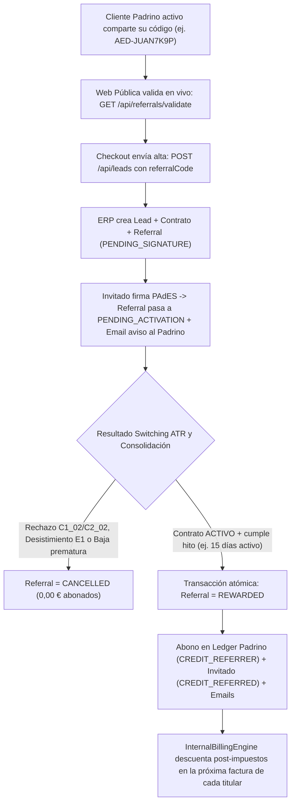

# Guía Completa del Módulo «Plan Amigo» (ERP Ultra · Multi-Comercializadora y Multi-Marca)

Este documento describe de principio a fin la arquitectura, reglas de negocio, contabilidad fiscal, controles antifraude, pantallas de Backoffice, Portal del Cliente e integración API S2S del módulo nativo **Plan Amigo (*Member-Get-Member*)** en **ERP Ultra**.

---

## 1. Visión General y Principios Rectores

El módulo **Plan Amigo** permite a cualquier comercializadora o marca del grupo lanzar campañas de recomendación (*"Invita a un amigo y ganad X € cada uno en vuestra factura"*) sin intervención manual, manteniendo trazabilidad financiera y regulatoria completa:

1. **Aislamiento Multi-Marca (`Brand`):**
   - Cada marca posee su propia configuración independiente en `BrandReferralConfig` (`brandId @unique`).
   - Una sociedad comercializadora puede activar el Plan Amigo en **AED Energía** (`AED-`, `25 € + 25 €` en `2.0TD` y `50 € + 50 €` en `3.0TD`) mientras lo mantiene desactivado (`isEnabled = false`) en el resto de marcas del ERP.
2. **Inmutabilidad Histórica (*Snapshot* en el momento del Alta):**
   - Al registrarse un alta con código de invitación, los importes prometidos al Padrino (`referrerRewardSnapshot`), al Invitado (`referredRewardSnapshot`), el hito de activación (`triggerMilestoneSnap`) y los días mínimos (`minActiveDaysSnap`) quedan **congelados** en la fila `Referral`.
   - Si la marca cambia importes o desactiva la campaña meses después, los contratos ya firmados respetan exactamente las condiciones vigentes el día de su contratación.
3. **Libro Mayor Inmutable (*Ledger* Transaccional):**
   - El saldo promocional nunca es un número suelto editable sin rastro: se calcula como la suma auditable de asientos en `ReferralWalletTransaction` protegidos mediante bloqueo pesimista de fila (`SELECT ... FOR UPDATE` sobre `Client`).
4. **Neutralidad Fiscal Absoluta (Descuento Financiero Post-Impuestos):**
   - Idéntico al tratamiento tributario del **Bolsillo Solar** en `InternalBillingEngine.ts`: el descuento `planAmigoUso` **jamás altera** los peajes/cargos ATR, ni el `Subtotal 1` sujeto al Impuesto Especial sobre la Electricidad (Modelo 560), ni la Base Imponible de `IVA` / `IGIC` / `IPSI`, ni la Tasa Municipal del 1,5 %.
   - Se deduce **después de impuestos** sobre el total líquido a pagar (`totalAmount`), garantizando que el recibo bancario SEPA nunca sea negativo (`>= 0,00 €`) y conservando automáticamente el remanente en el monedero para las siguientes facturas.
5. **Consolidación vinculada a Activación ATR Real (`SwitchingEvent`):**
   - Ningún premio se libera por la mera firma del contrato. El saldo permanece en espera (`PENDING_ACTIVATION`) hasta que la distribuidora confirma la activación ATR real (paso `05` -> contrato `ACTIVO`) y transcurren los días de consolidación configurados (por defecto **15 días**, cubriendo el plazo legal de desistimiento de 14 días `E1`).
6. **Blindaje Fiscal IRPF: Tope Máximo de `300,00 €/año natural` por Padrino (`Art. 75.3.f RIRPF`):**
   - Para evitar que las bonificaciones promocionales generen obligación de ingreso a cuenta de IRPF o declaración informativa en el **Modelo 190**, el sistema impone un techo legal insuperable de **`MAX_LEGAL_ANNUAL_REFERRAL_EUR = 300,00 €` por año natural (`Europe/Madrid`) y Padrino** (`BrandReferralConfig.maxAnnualRewardEur <= 300.0`, con `maxReferralsPerYear = 12` por defecto).
   - Este tope se controla tanto en la validación previa (computando lo ya abonado en `CREDIT_REFERRER` en el año en curso más los *snapshots* comprometidos en vuelo `PENDING_SIGNATURE` / `PENDING_ACTIVATION`, y acotando automáticamente el premio del Padrino al remanente disponible si p. ej. lleva `275,00 €` e invita un `3.0TD` de `50,00 €`, manteniendo intactos los `50,00 €` del Invitado) como de forma **atómica bajo `SELECT ... FOR UPDATE`** en el instante de consolidación o liberación administrativa.
7. **Aislamiento Total en *Shadow Billing* (`ENABLE_INTERNAL_BILLING_PRODUCTION`):**
   - Mientras el Motor Interno de Facturación opere en modo *Shadow Billing* (`ENABLE_INTERNAL_BILLING_PRODUCTION !== 'true'`, coexistiendo en paralelo con las facturas oficiales importadas de Ingebau), confirmar proformas internas simula visualmente el descuento `planAmigoUso`, pero **jamás** quema saldo real (`INVOICE_REDEMPTION` / `EXPIRATION`), ni ejecuta `INVOICE_REVERSAL`, ni dispara el hito `ON_FIRST_ISSUED_INVOICE` por facturas sombra.

---

## 2. Ciclo de Vida de una Recomendación



### Estados de `Referral` (`ReferralStatus`)
| Estado | Significado operativo |
| :--- | :--- |
| `PENDING_SIGNATURE` | El invitado ha iniciado el alta con código válido, pendiente de completar la firma electrónica PAdES. |
| `PENDING_ACTIVATION` | Contrato firmado y enviado al motor de Switching ATR (o ya `ACTIVO` esperando alcanzar `minActiveDaysSnap`). |
| `REWARDED` | Hito superado con éxito; ambos abonos han sido ingresados atómicamente en `ReferralWalletTransaction`. |
| `CANCELLED` | Anulado sin coste por rechazo ATR (`RECHAZO_ATR`), desistimiento legal (`DESISTIMIENTO_E1`), baja prematura (`BAJA_PREMATURA`), pérdida de vigencia del padrino (`PADRINO_SIN_CONTRATO_ACTIVO`) o anulación administrativa. |

### Tipos de Asiento en el Monedero (`WalletTxType`)
| Tipo | Signo | Descripción |
| :--- | :---: | :--- |
| `CREDIT_REFERRER` | `+` | Premio acreditado al Padrino tras consolidarse el suministro de su amigo. |
| `CREDIT_REFERRED` | `+` | Premio de bienvenida acreditado al Invitado tras consolidarse su suministro. |
| `INVOICE_REDEMPTION` | `-` | Consumo aplicado después de impuestos al confirmar una factura `EMITIDA` (`INT-YY-XXXX`). |
| `INVOICE_REVERSAL` | `+` | Restitución automática del saldo si se emite una factura de abono/rectificativa (`AB-YY-XXXX`) sobre una factura que consumió saldo. |
| `EXPIRATION` | `-` | Caducidad automática FIFO de saldo promocional no consumido tras superar `creditExpirationMonths`. |
| `MANUAL_ADJUSTMENT` | `+` / `-` | Ajuste manual auditado ejecutado por `SUPERADMIN` o `COMPANYADMIN` con usuario y motivo obligatorio. |

---

## 3. Reglas Antifraude y Elegibilidad (`validateReferralEligibility`)

Tanto en la pre-validación web (`GET /api/referrals/validate`) como en el cierre del alta (`POST /api/leads` / `createLeadAction`), el motor central `src/lib/services/ReferralEngine.ts` verifica secuencialmente **7 barreras antifraude**:

1. **Campaña activa en la Marca (`PROGRAM_DISABLED`):** `BrandReferralConfig.isEnabled === true` para el `X-Brand-Id`.
2. **Vigencia del Código y del Padrino (`CODE_NOT_FOUND` / `REFERRER_INACTIVE`):**
   - El código existe dentro de esa misma `Brand` y `Client.referralCodeActive === true`.
   - El Padrino mantiene **al menos 1 contrato `ACTIVO`** (o en transición firme de renovación `tipo = 'R'` según Regla 47) en esa marca. Si el Padrino causó baja, su código deja de ser utilizable automáticamente.
3. **Tarifa ATR elegible (`TARIFF_NOT_ALLOWED`):** La tarifa del suministro entrante está dentro de `allowedTariffs` (ej. `["2.0TD", "3.0TD"]`).
4. **Bloqueo de Auto-Recomendación (`SELF_REFERRAL_NOT_ALLOWED`):** Si `allowSelfReferral === false`, impide que un mismo `NIF/CIF/NIE` se invite a sí mismo (ej. segundas residencias del mismo titular).
5. **Bloqueo de Mismo IBAN Bancario (`SAME_IBAN_NOT_ALLOWED`):** Si `blockSameIban === true`, impide usar un IBAN de domiciliación que ya figure en contratos o puntos de suministro del Padrino.
6. **Enfriamiento Anti-Rotación por CUPS (`CUPS_RECENTLY_ACTIVE`):** Verifica los primeros 20 caracteres del CUPS (`ES00...`) e impide bonificar suministros que ya hayan estado activos o finalizados en la misma marca durante los últimos `cooldownMonthsSameCups` meses (por defecto **12 meses**) o que ya tengan una recomendación activa.
7. **Límite Anual por Padrino — Unidades y Tope Fiscal de `300,00 €` (`MAX_ANNUAL_LIMIT_REACHED`):**
   - Controla en huso oficial `Europe/Madrid` tanto el número máximo de invitaciones anuales (`maxReferralsPerYear`, por defecto `12`) como el **tope máximo económico anual de `300,00 €`** (`maxAnnualRewardEur <= 300,00 €`, Art. 75.3.f RIRPF).
   - En el alta (`createLeadAction` / `convertLeadToContractAction`), ambas comprobaciones y la unicidad por `CUPS20` se re-verifican dentro de transacción SQL bajo bloqueo pesimista `SELECT ... FOR UPDATE` sobre la fila `Client` del Padrino para impedir condiciones de carrera en peticiones S2S simultáneas.
   - Si un Lead nace inicialmente como **Oferta comercial** (`isOffer = true`) con `referralCode` o como Lead sin IBAN definitivo, el código se preserva en `contractData.referralCode` y, antes de consolidar el premio en `reconcileReferralsLifecycle`, el motor vuelve a auditar `NIF` (`AUTOCONTRATACION_NIF`) e `IBAN` (`MISMO_IBAN_PADRINO`) contra el `Contract` definitivo.

### Interacción con Comisiones de Canal (`CommissionEngine.ts`)
- Cuando `BrandReferralConfig.zeroChannelCommission === true` (activo por defecto) y un contrato procede de una invitación válida del Plan Amigo, `CommissionEngine.ts` fija automáticamente `commissionRuleType = 'PLAN_AMIGO_ZERO'` (`0,00 €` de comisión de canal externo), evitando pagar doble coste de adquisición (`CAC`).

---

## 4. Funcionamiento en Facturación Interna y PDF de Factura

### 4.1. Cálculo en Proforma / Borrador (`InternalBillingEngine.ts`)
1. Se calculan normalmente todos los términos regulados y comerciales: Potencia, Energía ATR, Energía Activa, Excesos, Excedentes, Impuesto Eléctrico, Bono Social, Alquiler, SVA e `IVA` / `IGIC` / `IPSI` (`totalSinDescuentoBolsillo`).
2. Si el suministro tiene **Bolsillo Solar**, se aplica primero `bolsilloSolarUso` -> `totalTrasBolsillo`.
3. A continuación, si `totalTrasBolsillo > 0`, el motor consulta el saldo vivo no caducado del cliente en `ReferralWalletTransaction` (`planAmigoSaldoInicial`):
   - `planAmigoUso = min(planAmigoSaldoInicial, totalTrasBolsillo)`
   - `planAmigoSaldoFinal = planAmigoSaldoInicial - planAmigoUso`
   - `totalAmount = totalTrasBolsillo - planAmigoUso` *(nunca inferior a `0,00 €`)*.
   - Si el cliente tenía `50,00 €` de saldo Plan Amigo y su factura con impuestos es de `34,20 €`, pagará **`0,00 €`** y conservará **`15,80 €`** disponibles para la factura del mes siguiente.

### 4.2. Confirmación Atómica, Persistencia JSON y Prevención de Doble Gasto (`/api/facturacion/interna/confirm`)
- `buildInternalInvoiceJsonData` (`internalInvoiceMapper.ts`) persiste siempre `hasPlanAmigo`, `planAmigoSaldoInicial`, `planAmigoUso` y `planAmigoSaldoFinal` en `InternalInvoice.invoiceData` desde la creación del borrador, garantizando coherencia matemática exacta (`0,00 €` de descuadre) entre borrador, confirmación, PDF, XML, ficha detallada y exportación CSV/Excel canónica.
- Al confirmar uno o varios borradores (`BORRADOR` -> `EMITIDA`) con `ENABLE_INTERNAL_BILLING_PRODUCTION === 'true'`, la ruta ejecuta expiración FIFO sobre `expiredAmountEur` (auditando únicamente saldo vencido no canjeado previamente sin doble expiración tras abonos), bloquea la fila `Client` (`FOR UPDATE`), verifica el saldo vivo en ese milisegundo e inserta `INVOICE_REDEMPTION`.
- Si un cliente **multipunto** tenía dos borradores generados a la vez que veían los mismos `25,00 €`, la primera factura confirmada consume los `25,00 €` y la segunda ajusta automáticamente su `planAmigoUso` y su `totalAmount` al saldo real restante antes de emitir el PDF y el XML.

### 4.3. Facturas Rectificativas y Abonos (`AB-YY-XXXX` + `R`)
- Si una factura emitida con descuento Plan Amigo es anulada o rectificada mediante un F1 de Abono (`AR` / `A` / `S`), `invertBillingResult` invierte `planAmigoUso` y preserva el importe histórico emitido aunque se recalcule el detalle horario.
- Cuando se calcula o confirma un par **`AR` (Abono) + `R` (Rectificadora)** del mismo ciclo, `InternalBillingEngine.ts` proyecta en el borrador `R` el saldo que restituirá su `AR` compañero y `/api/facturacion/interna/confirm` **ordena siempre los `Abonos` antes que las `Rectificadoras` / `Normales`** dentro de la transacción SQL: el `AR` ejecuta primero `INVOICE_REVERSAL` (`+planAmigoUso`) y la nueva `R` reaplica automáticamente ese saldo en la factura rectificada.

### 4.4. Representación Visual en PDF, Ficha Detallada, Excel y XML
Respetando íntegramente las 8 secciones reglamentarias de `.agents/AGENTS.md`:
- **PDF (`InvoicePdfTemplate.tsx`):** En la columna derecha de totales (justo encima de **`Total FACTURA`**) aparece en verde `Descuento Plan Amigo aplicado: -XX,XX €`, y en la columna izquierda la tabla **`Tu Monedero Plan Amigo`** (`Saldo anterior | Aplicado | Disponible`). El parámetro `dto` del QR oficial CNMC acumula automáticamente el descuento aplicado para cuadrar al céntimo con `imp`.
- **Ficha Detallada (`/facturas/[id]` y `/facturas-internas/[id]` — `InvoiceDetailClient.tsx`):** Muestra la tarjeta esmeralda **`Tu Monedero Plan Amigo en esta Factura`** en la Sección 6 y las líneas **`Total antes de Monederos`** / **`Descuento Plan Amigo`** sobre **`Total Importe Factura`** en la Sección 7.
- **Exportación Excel (`/api/facturacion/interna/export-excel/[draftId]`):** Preserva los importes históricos emitidos (`bolsilloSolarUso`, `planAmigoUso`, `totalAmount`) en facturas `EMITIDA`/`ABONO` e incluye el bloque final de liquidación en la pestaña Resumen.
- **XML Factura Interna (`invoiceXmlTemplate.ts`):** Exporta `<DescuentoPlanAmigo>`, `<SaldoInicialPlanAmigo>` y `<SaldoFinalPlanAmigo>` dentro de `<Importes>`.

---

## 5. Gestión desde el Backoffice ERP y Portal del Cliente

### 5.1. Configuración por Marca (`/ajustes` -> pestaña «Plan Amigo»)
Accesible para `SUPERADMIN` y `COMPANYADMIN` (reactivo al selector superior `<BrandSelector />`):
- Activar o pausar el Plan Amigo en la marca seleccionada.
- Definir prefijo (`AED-`), premios para `2.0TD` y premios diferenciados opcionales para `3.0TD+`.
- Elegir tarifas admitidas (`2.0TD`, `3.0TD`, `6.1TD`, `6.2TD`), hito de liberación (`ON_DAYS_ACTIVE`, `ON_ATR_ACTIVATION`, `ON_FIRST_ISSUED_INVOICE`), días mínimos activo, enfriamiento de CUPS, tope anual, caducidad del saldo y URL de bases legales.
- Botón **«Generar códigos para clientes activos sin código»** para ejecutar el *backfill* masivo en 1 clic sobre toda la cartera vigente de esa marca.

### 5.2. Centro de Control Operativo (`/plan-amigo` — menú `CRM Ventas`)
Accesible para `SUPERADMIN`, `COMPANYADMIN` y `BACKOFFICE`:
- **4 KPIs en tiempo real:** *Invitaciones en trámite*, *Contratos consolidados*, *Saldo total emitido (€)* y *Pasivo vivo pendiente de canjear (€)*.
- Buscador instantáneo por código, CUPS, NIF o nombre (Padrino/Invitado) y filtros por estado.
- Botón **«Consolidar hitos ATR»** para forzar en cualquier momento la reconciliación que también ejecuta cada madrugada (`06:00 UTC`) el cron automático `/api/cron/process-referrals`.
- Acciones administrativas por fila (`SUPERADMIN` / `COMPANYADMIN`): **Abonar** anticipadamente o **Anular** con motivo auditado.

### 5.3. Ficha Individual de Cliente (`/clientes/[id]` -> pestaña «Plan Amigo y Monedero»)
- Visualización del código personal (`AED-...`), enlace directo de invitación, interruptor para bloquear/desbloquear el código en caso de spam en redes públicas y botón para **enviarle su código por email corporativo**.
- Trazabilidad de quién invitó a ese titular (si entró como referido) y tabla completa de amigos traídos por él con el estado de sus contratos ATR.
- **Libro Mayor (Ledger)** completo de movimientos con enlace a las facturas donde se descontó saldo y botón **«Ajuste manual auditado»** (`SUPERADMIN` / `COMPANYADMIN`).

### 5.4. Área de Cliente (`/plan-amigo` -> «Invita y Gana» para rol `CLIENT`)
- Se muestra automáticamente en el menú lateral del Área de Cliente cuando `BrandReferralConfig.isEnabled === true` para su marca **o cuando el titular ya dispone de saldo/historial previo en su monedero** (permitiéndole consultar su saldo pendiente de descontar incluso si la marca cierra temporalmente la captación de nuevas altas).
- Tarjeta personalizada con los colores corporativos y dominio propio de la marca (sin fugas de dominio entre comercializadoras), indicación transparente del tope fiscal anual (`300,00 €/año`), botón de **Copiar enlace / código**, **Compartir por WhatsApp**, **Enviar por Email**, resumen de ahorro acumulado y estado anonimizado de sus amigos invitados (cumpliendo estrictamente el RGPD).

---

## 6. Referencia de Integración API S2S para Webs Públicas (ej. `www.aed-energia.com`)

Todas las llamadas Server-to-Server desde la web pública deben incluir las cabeceras estándar del ERP:
```http
Authorization: Bearer <AED_API_KEY>
X-Brand-Id: cmq6j25l50001d441e0c06g9t
```

### 6.1. Consultar configuración activa de la marca
`GET https://ultra.sp-energia.com/api/referrals/config`

**Respuesta `200 OK`:**
```json
{
  "success": true,
  "data": {
    "isEnabled": true,
    "codePrefix": "AED-",
    "referrerRewardEur": 25,
    "referredRewardEur": 25,
    "referrerReward30tdEur": 50,
    "referredReward30tdEur": 50,
    "allowedTariffs": ["2.0TD", "3.0TD"],
    "triggerMilestone": "ON_DAYS_ACTIVE",
    "minActiveDays": 15,
    "maxReferralsPerYear": 12,
    "maxAnnualRewardEur": 300,
    "legalTermsUrl": "https://www.aed-energia.com/condiciones-generales#plan-amigo"
  }
}
```

### 6.2. Validar código en tiempo real (Landing `?ref=...` o Checkout)
`GET https://ultra.sp-energia.com/api/referrals/validate?code=AED-JUAN7K9P&tariff=2.0TD&cups=ES00...&vatNumber=12345678Z`

- Protegido con *rate-limiting* por IP (`30 req / min`) y enmascaramiento estricto RGPD (jamás expone apellidos completos, DNI, email, teléfono ni dirección del Padrino).

**Respuesta `200 OK` (Válido):**
```json
{
  "success": true,
  "valid": true,
  "data": {
    "code": "AED-JUAN7K9P",
    "referrerDisplayName": "Juan C.",
    "referredRewardEur": 25,
    "referrerRewardEur": 25
  }
}
```

**Respuesta `200 OK` (No aplicable):**
```json
{
  "success": true,
  "valid": false,
  "errorCode": "SELF_REFERRAL_NOT_ALLOWED",
  "message": "El Plan Amigo aplica a nuevos titulares distintos de la persona que invita."
}
```
*Códigos de error estandarizados:* `PROGRAM_DISABLED`, `CODE_NOT_FOUND`, `REFERRER_INACTIVE`, `TARIFF_NOT_ALLOWED`, `SELF_REFERRAL_NOT_ALLOWED`, `SAME_IBAN_NOT_ALLOWED`, `CUPS_RECENTLY_ACTIVE`, `MAX_ANNUAL_LIMIT_REACHED`, `RATE_LIMITED`.

### 6.3. Envío del Alta con Código de Recomendación
`POST https://ultra.sp-energia.com/api/leads` (`multipart/form-data`)

- Añadir el campo opcional `referralCode` en el `FormData` (o dentro del JSON `contractData.referralCode`).
- Si `referralCode` viene vacío, el endpoint opera exactamente igual que un alta ordinaria.
- Si `referralCode` viene informado y falla alguna validación final (por ejemplo, mismo IBAN introducido en el último paso del checkout), devuelve `HTTP 400` con `{ success: false, errorCode, message }` para que la web informe al cliente antes de firmar.
- Si es válido, crea atómicamente `Lead` + `Contract` (si `autoGenerateContract=true`) + `Referral` y devuelve:
```json
{
  "success": true,
  "leadId": "cm...",
  "contractId": "cm...",
  "referral": {
    "id": "cm...",
    "code": "AED-JUAN7K9P",
    "referredRewardEur": 25,
    "referrerRewardEur": 25,
    "status": "PENDING_SIGNATURE"
  }
}
```

---

## 7. Mapa de Archivos Técnicos del Módulo

- **Esquema de Datos:** `prisma/schema.prisma` (`BrandReferralConfig`, `Referral`, `ReferralWalletTransaction`, `Client.referralCode`).
- **Motor Central y Antifraude:** `src/lib/services/ReferralEngine.ts`.
- **Emails Transaccionales por Marca:** `src/lib/services/referralEmails.ts`.
- **Endpoints S2S y Cron Diario:**
  - `src/app/api/referrals/config/route.ts`
  - `src/app/api/referrals/validate/route.ts`
  - `src/app/api/leads/route.ts` + `src/app/actions/leadActions.ts`
  - `src/app/api/cron/process-referrals/route.ts` (programado en `vercel.json` a las `0 6 * * *`)
- **Hooks en Contratos, Comisiones, Firma y Switching:**
  - `src/app/actions/contractActions.ts`
  - `src/lib/services/CommissionEngine.ts`
  - `src/app/actions/signatureActions.ts`
  - `src/app/actions/switchingIngest.ts`
- **Motor de Facturación, PDF, XML, Ficha y Excel:**
  - `src/lib/services/InternalBillingEngine.ts`
  - `src/lib/services/internalInvoiceMapper.ts`
  - `src/app/api/facturacion/interna/confirm/route.ts`
  - `src/app/api/facturacion/interna/export-excel/[draftId]/route.ts`
  - `src/components/pdf/InvoicePdfTemplate.tsx`
  - `src/lib/templates/invoiceXmlTemplate.ts`
  - `src/app/(app)/facturas/[id]/InvoiceDetailClient.tsx`
- **Backoffice y Portal del Cliente:**
  - `src/app/actions/referralActions.ts`
  - `src/app/(app)/ajustes/PlanAmigoSettingsPanel.tsx`
  - `src/app/(app)/plan-amigo/page.tsx` y `src/app/(app)/plan-amigo/PlanAmigoClient.tsx`
  - `src/components/clientes/ClientReferralTab.tsx`
