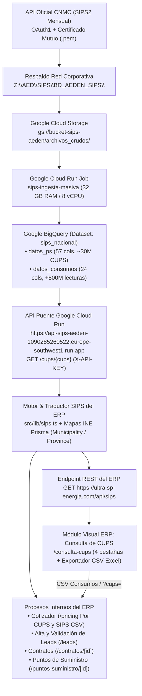

# Manual Técnico y Operativo del Sistema SIPS Corporativo (`SIPS.md`)

**Estado:** En Producción (`READY` en `https://ultra.sp-energia.com`)  
**Última actualización:** 14 de Noviembre de 2026  
**Alcance:** Documentación integral de la infraestructura de datos CNMC en Google Cloud, la API corporativa SIPS, el motor traductor interno del ERP, el visor frontend **Consulta de CUPS**, los exportadores CSV para Excel/Cotizador y todos los flujos del ERP conectados al sistema SIPS propio.

---

## 1. Visión General de la Arquitectura SIPS

El ERP cuenta con un **Sistema de Información de Puntos de Suministro (SIPS) 100% propio**, independiente de proveedores externos (como Ingebau), pero manteniendo **compatibilidad exacta 1:1 con el contrato JSON y CSV histórico de Ingebau** para que todos los módulos del ERP operen de forma transparente.



---

## 2. Dónde se Aloja la Base de Datos CNMC y la Infraestructura Cloud

Dado el volumen masivo de los ficheros nacionales SIPS2 publicados mensualmente por la CNMC (**~133 GB descomprimidos por cada mes**), la base de datos SIPS está desacoplada de la base de datos transaccional PostgreSQL del ERP (`pooled.db.prisma.io`, ~1,8 GB) y se aloja en **Google Cloud Platform (GCP)**:

### 2.1. Mapa de Alojamiento e Infraestructura

| Componente | Plataforma / Ubicación | Identificador / Ruta Exacta | Función |
| :--- | :--- | :--- | :--- |
| **Proyecto Google Cloud** | Google Cloud Platform | `custom-cycling-496811-q2` (`europe-southwest1` - Madrid) | Entorno cloud corporativo de datos y microservicios SIPS. |
| **Repositorio Local / Red** | Servidor Local (`Z:\`) | `Z:\AED\SIPS\BD_AEDEN_SIPS\` | Custodia histórica de los `.zip` descargados de la CNMC, certificados y scripts de soporte/ingesta. |
| **Almacenamiento de ZIPs en Nube** | Google Cloud Storage (GCS) | `gs://bucket-sips-aeden/archivos_crudos/` | Bucket donde se depositan los `.zip` oficiales de PS y Consumos antes de volcarlos en BigQuery. |
| **Proceso ETL de Carga Masiva** | Google Cloud Run Jobs | Job: `sips-ingesta-masiva` (Imagen `sips-ingesta-v2:latest`, `32Gi` RAM, `8` vCPU, timeout `28800s`) | Descomprime en memoria RAM los `.zip` desde GCS e inyecta los ~133 GB en BigQuery (`WRITE_TRUNCATE`) en ~39,5 min. |
| **Base de Datos SIPS Activa** | **Google BigQuery** | Dataset: `custom-cycling-496811-q2.sips_nacional`<br>• Tabla `datos_ps`<br>• Tabla `datos_consumos` | Base de datos analítica serverless que almacena el censo nacional completo de CUPS y sus lecturas históricas. |
| **API Cloud SIPS (Backend GCP)** | **Google Cloud Run** | `https://api-sips-aeden-1090285260522.europe-southwest1.run.app` | Microservicio FastAPI/Python que consulta BigQuery por prefijo de 20 caracteres del CUPS y devuelve los registros crudos CNMC protegidos por `X-API-KEY`. |
| **ERP Frontend + API Drop-In** | **Vercel (Producción)** | `https://ultra.sp-energia.com` (Proyecto Vercel: `sp-erp-comercializadoras`) | Aloja el ERP Next.js, el traductor `src/lib/sips.ts`, el endpoint `/api/sips`, el visor `/consulta-cups` y el exportador CSV `src/lib/sipsCsvExporter.ts`. |
| **Diccionarios Geográficos INE** | **PostgreSQL (Prisma)** | Tablas `Municipality` (8.203 códigos INE) y `Province` (52 códigos INE) | Traducen en memoria los códigos numéricos INE de la CNMC (`"14075"`, `"14"`) a nombres oficiales (`"Zuheros"`, `"Córdoba"`). |

### 2.2. Obtención de los Ficheros Oficiales desde la CNMC
Los ficheros mensuales SIPS2 se obtienen del portal de APIs de la CNMC:
- **Endpoint CNMC**: `https://api.cnmc.gob.es/ficheros/v1/consultar?idProcedimiento=2&nifEmpresa=B10915544&estado=DISPONIBLE`
- **Autenticación**: `OAuth1` + Certificado digital de representante (`certificado_aeden.pem`, extraído desde el `.p12` mediante `Z:\AED\SIPS\BD_AEDEN_SIPS\convertir_certificado.py` y utilizado por `0_descargador_masivo_cnmc.py`).
- **Archivos mensuales entregados por la CNMC (ámbito peninsular)**:
  1. `YYYYMM_SIPS2_PS_ELECTRICIDAD_peninsular.zip` (~985 MB comprimido $\rightarrow$ **~8,68 GB** CSV descomprimido).
  2. `YYYYMM_SIPS2_CONSUMOS_ELECTRICIDAD_peninsular.zip` (~23,05 GB comprimido $\rightarrow$ **~124,23 GB** CSV descomprimido).

---

## 3. Estructura de las Tablas de Base de Datos CNMC en BigQuery

En el dataset `sips_nacional` de Google BigQuery existen dos tablas cuyos nombres de columna están normalizados en minúsculas:

### 3.1. Tabla `sips_nacional.datos_ps` (57 Columnas — Maestro de Puntos de Suministro)
Contiene una fila por cada CUPS nacional con sus características técnicas y contractuales:

| # | Columna en BigQuery (`datos_ps`) | Contenido / Unidad Original CNMC | Traducción Aplicada en el ERP (`src/lib/sips.ts`) |
| :--- | :--- | :--- | :--- |
| 1 | `codigoempresadistribuidora` | Código REE distribuidora (`"0031"`, `"0022"`) | `CódigoDistribuidora` sin ceros a la izquierda (`"31"`) + `codigoDistribuidora` (`"0031"`). |
| 2 | `cups` | CUPS completo de 22 caracteres | `CUPS` en mayúsculas. Se busca por los primeros 20 caracteres (`cups20`). |
| 3 | `nombreempresadistribuidora` | Razón social de la distribuidora | `NombreDistribuidora` / `distribuidora`. |
| 4 | `codigopostalps` | Código postal de 5 dígitos | `CódigoPostalPS` / `cp` (saneado automáticamente a 5 dígitos españoles `01001..52999` mediante `normalizeSpanishPostalCodeOrNull` en [`src/lib/postalCode.ts`](../src/lib/postalCode.ts)). |
| 5 | `municipiops` | Código INE municipio (5 dígitos, ej. `"14075"`) | Cruzado con tabla Prisma `Municipality` $\rightarrow$ `MunicipioPS` / `poblacion` (`"Zuheros"`). |
| 6 | `codigoprovinciaps` | Código INE provincia (2 dígitos, ej. `"14"`) | Cruzado con tabla Prisma `Province` $\rightarrow$ `ProvinciaPS` / `provincia` (`"Córdoba"`). |
| 7 | `fechaaltasuministro` | Fecha `YYYY-MM-DD` | `FechaAltaPS` (mostrada como `DD/MM/YYYY` en el visor). |
| 8 | `codigotarifaatrenvigor` | Código CNMC (`"018"`, `"019"`, `"020"`...) | `TarifaATR` / `tarifa`: `018`$\rightarrow$`2.0TD`, `019`$\rightarrow$`3.0TD`, `020`$\rightarrow$`6.1TD`, `021`$\rightarrow$`6.2TD`, `022`$\rightarrow$`6.3TD`, `023`$\rightarrow$`6.4TD`, `024`/`026`$\rightarrow$`3.0TDVE`, `025`/`027`$\rightarrow$`6.1TDVE`. |
| 9 | `codigotensionv` | Código numérico de tensión (`"02"`, `"06"`...) | `Tension`: `01`$\rightarrow$`1X127`, `02`$\rightarrow$`1X230`, `03`$\rightarrow$`1X220`, `04`$\rightarrow$`3X230`, `05`$\rightarrow$`3X380`, `06`$\rightarrow$`3X400`, `09`..`20`$\rightarrow$rangos AT (`1KV-11KV`..`220KV-400KV`). |
| 10 | `potenciamaximabiew` | Potencia máx. boletín BIE en **Vatios (`W`)** | Dividida `/ 1000` $\rightarrow$ `PotenciaMaxBIE(kW)`. |
| 11 | `potenciamaximaapmw` | Potencia máx. acta APM en **Vatios (`W`)** | Dividida `/ 1000` $\rightarrow$ `potenciaMaximaAPM(KW)`. |
| 12 | `codigoclasificacionps` | Punto de medida (`"01"` a `"05"`) | `TipoPM`: `"Tipo 1"` a `"Tipo 5"`. |
| 13 | `codigodisponibilidadicp` | Disponibilidad ICP (`"0"` / `"1"`) | `codigoDisponibilidadICP`. |
| 14 | `tipoperfilconsumo` | Perfil REE (`"P2.0TD"`, `"P3.0TD"`) | `tipoPerfilConsumo`. |
| 15 | `valorderechosextensionw` | Derechos de extensión en **Vatios (`W`)** | Dividido `/ 1000` $\rightarrow$ `valorDerechosExtensionkW`. |
| 16 | `valorderechosaccesow` | Derechos de acceso en **Vatios (`W`)** | Dividido `/ 1000` $\rightarrow$ `valorDerechosAccesokW`. |
| 17 | `codigopropiedadequipomedida` | Propiedad contador (`1`..`4`) | `Propietario EM`: `1`$\rightarrow$`Distribuidor`, `2`$\rightarrow$`Cliente`, `3`$\rightarrow$`Comercializador`, `4`$\rightarrow$`Otros`. |
| 18 | `codigopropiedadicp` | Propiedad ICP (`1`..`4`) | `codigoPropiedadICP` (mismo catálogo de propiedad). |
| 19–24 | `potenciascontratadasenwp1` .. `p6` | Potencias contratadas P1..P6 en **Vatios (`W`)** | Divididas `/ 1000` $\rightarrow$ `PotenciaContratadaP1kW`..`P6kW` y campos raíz `p1`..`p6` en `kW`. |
| 25–28 | `fechaultimomovimientocontrato`, `fechaultimocambiocomercializador`, `fechalimitederechosreconocidos`, `fechaultimalectura` | Fechas regulatorias (`YYYY-MM-DD`) | Mapeadas con nombres exactos camelCase en `data.ps[0]`. |
| 29–33 | `informacionimpagos`, `importedepositogarantiaeuros`, `tipoidtitular`, `esviviendahabitual`, `codigocomercializadora` | Indicadores administrativos | Normalizados en `data.ps[0]`. |
| 34 | `codigotelegestion` | Estado telegestión (`"01"`, `"02"`, `"03"`) | `01`$\rightarrow$`Telegestión operativa con curva de carga horaria`, `02`$\rightarrow$`Telegestión operativa sin curva de carga horaria`, `03`$\rightarrow$`Sin telegestión`. |
| 35–45 | `codigofasesequipomedida`, `codigoautoconsumo`, `codigotipocontrato`, `codigoperiodicidadfacturacion`, `codigobie`, `fechaemisionbie`, `fechacaducidadbie`, `codigoapm`, `fechaemisionapm`, `fechacaducidadapm`, `relaciontransformacionintensidad` | Datos técnicos de equipo, BIE, APM y autoconsumo | `codigoAutoconsumo` (`"00"` normalizado a `"0"` y descrito en el visor según códigos RD 244/2019: `31`, `41`, `42`, `43`, `51`, etc.). |
| 46–57 | `cnae`, `codigomodocontrolpotencia`, `potenciacgpw` (`W`$\rightarrow$`kW`), `codigodhequipodemedida`, `codigoaccesibilidadcontador`, `codigopscontratable`, `motivoestadonocontratable`, `codigotensionmedida`, `codigoclaseexpediente`, `codigomotivoexpediente`, `codigotiposuministro`, `aplicacionbonosocial` | CNAE, contratabilidad y Bono Social | Mapeados en `data.ps[0]`, incluyendo validación visual de suministro contratable / no contratable. |

> **Cálculo Dinámico de Consumos Anuales en `data.ps[0]`**: La tabla `datos_ps` de la CNMC no incluye columnas de consumo anual. Nuestro motor `src/lib/sips.ts` calcula al vuelo **`ConsumoAnualP1kWh`..`ConsumoAnualP6kWh`**, **`ConsumoAnualkWh`** y **`ConsumoAnualAnterior`** sumando `consumoenergiaactivaenwhpX / 1000` (redondeado a 2 decimales) de todos los ciclos de lectura cuya ventana `[fechainiciomesconsumo, fechafinmesconsumo]` esté comprendida dentro de los últimos **365 días** respecto a la última fecha de lectura cerrada (`max(fechafinmesconsumo)`).

### 3.2. Tabla `sips_nacional.datos_consumos` (24 Columnas — Histórico de Lecturas)
Contiene los últimos ~36 ciclos de facturación/lectura de cada CUPS:

| # | Columna en BigQuery (`datos_consumos`) | Contenido / Unidad Original CNMC | Traducción Aplicada en el ERP (`data.consumos[]`) |
| :--- | :--- | :--- | :--- |
| 1 | `cups` | CUPS de 22 caracteres | `CUPS` |
| 2 | `fechainiciomesconsumo` | Inicio de lectura (`YYYY-MM-DD`) | `LecturaDesde` |
| 3 | `fechafinmesconsumo` | Fin de lectura (`YYYY-MM-DD`) | `LecturaHasta` (ordenado de más reciente a más antiguo) |
| 4 | `codigotarifaatr` | Código numérico CNMC (`"018"`, `"019"`...) | `TarifaATR` (`"2.0TD"`, `"3.0TD"`, `"6.1TD"`, etc.) |
| 5–10 | `consumoenergiaactivaenwhp1` .. `p6` | Energía activa en **Vatios-hora (`Wh`)** | Dividida `/ 1000` y redondeada a entero $\rightarrow$ `EnergiaActivaP1(kWh)` .. `EnergiaActivaP6(kWh)` |
| 11–16 | `consumoenergiareactivaenvarhp1` .. `p6` | Energía reactiva en **`VArh`** | Redondeada a entero $\rightarrow$ `EnergíaReactivaP1(Varh)` .. `EnergíaReactivaP6(Varh)` |
| 17–22 | `potenciademandadaenwp1` .. `p6` | Maxímetro demandado en **Vatios (`W`)** | Dividida `/ 1000` con 3 decimales $\rightarrow$ `MaxímetroP1(kW)` .. `MaxímetroP6(kW)` |
| 23 | `codigodhequipodemedida` | Código discriminación horaria | `codigoDHEquipoDeMedida` |
| 24 | `codigotipolectura` | Tipo lectura (`60`, `10`, `30`, `20`, `40`...) | `codigoTipoLectura` + `TipoLectura`: `60`$\rightarrow$`Telegestión` (`REAL`), `10`/`30`/`50`$\rightarrow$`Real` (`REAL`), `20`/`40`/`70`/`99`$\rightarrow$`Estimada` (`ESTIMADO`) |

---

## 4. Funcionamiento de la API SIPS

Existen **dos niveles de API** trabajando en cadena:

### 4.1. Nivel 1: Microservicio Cloud Run sobre BigQuery (Uso Interno Backend)
- **URL Base**: `https://api-sips-aeden-1090285260522.europe-southwest1.run.app`
- **Ruta**: `GET /cups/{cups}` (acepta 20 o 22 caracteres; filtra en BigQuery por `STARTS_WITH(cups, SUBSTR(@cups, 1, 20))`).
- **Cabecera de Seguridad**: `X-API-KEY: <SIPS_API_KEY>`
- **Variables de Entorno en `.env` y en Vercel Producción**:
  - `SIPS_API_URL="https://api-sips-aeden-1090285260522.europe-southwest1.run.app"`
  - `SIPS_API_KEY="<clave_configurada_en_vercel_y_env>"`
- **Respuesta**: JSON crudo `{ "ps": { ...57 cols... }, "consumos": [ ...24 cols... ] }`.

### 4.2. Nivel 2: API Oficial del ERP (`GET /api/sips`) — Formato 100% Compatible con Ingebau
- **Archivo fuente**: `src/app/api/sips/route.ts` (apoyado en `src/lib/sips.ts`, con `maxDuration = 60` segundos en Vercel y caché en memoria de 10 minutos por `CUPS20`).
- **URL en Producción**: `https://ultra.sp-energia.com/api/sips`
- **Métodos de Autenticación aceptados**:
  1. **Sesión de usuario del ERP (NextAuth Cookie)**: Cualquier usuario autenticado con rol `SUPERADMIN`, `COMPANYADMIN`, `BACKOFFICE`, `COMERCIAL` o `CANAL` (el rol `CLIENT` recibe `403 Forbidden` por normativa de confidencialidad SIPS).
  2. **API Key Máquina-a-Máquina (Scripts externos / Integraciones)**: Enviando cabecera `X-API-KEY: <API_KEY>` o `Authorization: Bearer <API_KEY>` (valida contra `AED_API_KEY` y `SIPS_API_KEY`).
- **Auditoría**: Cada petición registra en los logs del servidor `[SIPS AUDIT] Actor="..." CUPS="..." Format="..."`.

#### Parámetros Query (`GET /api/sips`)
| Parámetro | Obligatorio | Valores | Descripción |
| :--- | :---: | :--- | :--- |
| `cups` | Sí | `ES00...` (20 o 22 chars) | Código CUPS a consultar (con o sin los 2 dígitos finales de control). |
| `format` | No | `json` *(defecto)* \| `csv_consumos` \| `csv_ps` | Devuelve el JSON estructurado o descarga directamente los archivos CSV listos para Excel/Cotizador. |
| `refresh` | No | `1` \| `true` | Ignora la caché en memoria de 10 minutos y fuerza lectura directa contra Google Cloud Run / BigQuery. |

#### Ejemplos de Uso por API (`curl`)
```bash
# 1. Obtener JSON completo formato Ingebau
curl -H "X-API-KEY: <TU_API_KEY>" \
  "https://ultra.sp-energia.com/api/sips?cups=ES0031101457409001HM"

# 2. Descargar directamente el CSV de Consumos (23 columnas) por API
curl -OJ -H "X-API-KEY: <TU_API_KEY>" \
  "https://ultra.sp-energia.com/api/sips?cups=ES0031101457409001HM&format=csv_consumos"

# 3. Descargar directamente el CSV de Datos del Punto de Suministro (36 columnas) por API
curl -OJ -H "X-API-KEY: <TU_API_KEY>" \
  "https://ultra.sp-energia.com/api/sips?cups=ES0031101457409001HM&format=csv_ps"
```

#### Estructura del JSON Devuelto (`format=json`)
```json
{
  "success": true,
  "data": {
    "result": "OK",
    "messages": "",
    "tarifa": "2.0TD",
    "p1": 4.4,
    "p2": 4.4,
    "p3": 0,
    "p4": 0,
    "p5": 0,
    "p6": 0,
    "cp": "14870",
    "poblacion": "Zuheros",
    "municipio": "Zuheros",
    "provincia": "Córdoba",
    "codigoProvincia": "14",
    "codigoMunicipio": "14075",
    "distribuidora": "ENDESA DISTRIBUCION ELECTRICA, S.L.",
    "codigoDistribuidora": "0031",
    "cnae": "9820",
    "autoconsumo": "0",
    "consumo": 3291.69,
    "data": {
      "ps": [
        {
          "CUPS": "ES0031101457409001HM0F",
          "TarifaATR": "2.0TD",
          "Tension": "1X230",
          "TipoPM": "Tipo 5",
          "MunicipioPS": "Zuheros",
          "ProvinciaPS": "Córdoba",
          "CódigoPostalPS": "14870",
          "NombreDistribuidora": "ENDESA DISTRIBUCION ELECTRICA, S.L.",
          "CódigoDistribuidora": "31",
          "PotenciaContratadaP1kW": "4.4",
          "PotenciaContratadaP2kW": "4.4",
          "ConsumoAnualkWh": 3291.69,
          "ConsumoAnualP1kWh": 903.69,
          "ConsumoAnualP2kWh": 993.91,
          "ConsumoAnualP3kWh": 1394.09,
          "ConsumoAnualAnterior": 2742.6,
          "Propietario EM": "Distribuidor",
          "codigoTelegestion": "Telegestión operativa con curva de carga horaria"
        }
      ],
      "consumos": [
        {
          "CUPS": "ES0031101457409001HM0F",
          "LecturaDesde": "2026-02-15",
          "LecturaHasta": "2026-03-15",
          "TipoLectura": "Telegestión",
          "codigoTipoLectura": "60",
          "TarifaATR": "2.0TD",
          "EnergiaActivaP1(kWh)": 123,
          "EnergiaActivaP2(kWh)": 114,
          "EnergiaActivaP3(kWh)": 115,
          "EnergiaActivaP4(kWh)": 0,
          "EnergiaActivaP5(kWh)": 0,
          "EnergiaActivaP6(kWh)": 0,
          "MaxímetroP1(kW)": 3.38,
          "MaxímetroP2(kW)": 0,
          "MaxímetroP3(kW)": 3.924,
          "MaxímetroP4(kW)": 0,
          "MaxímetroP5(kW)": 0,
          "MaxímetroP6(kW)": 0,
          "EnergíaReactivaP1(Varh)": 0,
          "EnergíaReactivaP2(Varh)": 0,
          "EnergíaReactivaP3(Varh)": 0,
          "EnergíaReactivaP4(Varh)": 0,
          "EnergíaReactivaP5(Varh)": 0,
          "EnergíaReactivaP6(Varh)": 0
        }
      ]
    }
  }
}
```

---

## 5. Módulo Visual Frontend: `Consulta de CUPS` (`/consulta-cups`)

Ubicado en `src/app/(app)/consulta-cups/page.tsx` y accesible desde el menú lateral del ERP en **`SIPS` $\rightarrow$ `Consulta de CUPS`** para los roles `SUPERADMIN`, `COMPANYADMIN`, `BACKOFFICE`, `COMERCIAL` y `CANAL`.

### 5.1. Funcionalidades del Visor
1. **Buscador Inteligente por CUPS**:
   - Acepta CUPS de 20 o 22 caracteres (limpia espacios y convierte a mayúsculas automáticamente).
   - Permite navegación directa por URL mediante `/consulta-cups?cups=ES00...`.
   - Guarda en `sessionStorage` las últimas 6 consultas de la sesión como chips de acceso instantáneo y ofrece un botón de refresco (`refresh=1`) para saltar caché si se desea.
2. **Aviso Legal Reglamentario Desplegable**:
   - Incluye el texto normativo obligatorio conforme a la **Ley 24/2013 del Sector Eléctrico**, **RD 1011/2009** y **RD 1435/2002**, adaptado dinámicamente a la marca activa en el selector del ERP (`AED Energía`, `SP Energía`, etc.).
3. **Cabecera Resumen del Suministro**:
   - Muestra de un vistazo el CUPS completo de 22 caracteres, badge de tarifa ATR, badge de contratabilidad (`Contratable` en verde / `No contratable` en rojo con motivo), CP + Municipio + Provincia, Distribuidora y Consumo Anual total con el número de lecturas disponibles.
4. **4 Pestañas de Información Técnica**:
   - **`Datos generales`**: Identificación completa, distribuidora, población/provincia, tarifa, potencias contratadas `P1..P6` (`kW`), potencia máxima BIE y APM, derechos de extensión y acceso, tensión, tipo de punto de medida, fechas de última modificación de contrato, último cambio de comercializador, última lectura, alta de suministro y límite de derechos reconocidos, propiedad de ICP y contador, estado de telegestión, relación de transformación, autoconsumo, CNAE, vivienda habitual y Bono Social.
   - **`Lecturas de activa`**: Tarjetas superiores con el **Consumo anual estimado (`P1..P6` + Total en `kWh`)** y comparativa frente al año móvil anterior, seguidas de la tabla completa de lecturas históricas (`Fecha`, `Periodo Desde → Hasta`, badge `REAL` / `ESTIMADO`, `Tarifa`, `Consumo P1..P6` y `Total kWh` por ciclo).
   - **`Lecturas de reactiva`**: Tarjetas superiores con el resumen anual de reactiva (`P1..P6` + Total en `Varh`) y tabla histórica completa por ciclo.
   - **`Lecturas de maxímetro`**: Tarjetas superiores que enfrentan **Potencia Contratada vs. Pico Máximo Registrado (`kW`)** por cada periodo `P1..P6`, iluminando automáticamente en **ámbar** los periodos y lecturas donde el cliente ha superado la potencia contratada (ideal para estudios de optimización de potencia).
5. **Barra de Acciones Rápidas**:
   - **`CSV Consumos (Cotizador)`**: Descarga `{CUPS}_consumos.csv`.
   - **`CSV Datos PS`**: Descarga `{CUPS}_ps.csv`.
   - **`Cotizar CUPS`** *(visible para `SUPERADMIN`, `COMPANYADMIN`, `BACKOFFICE`)*: Abre `/pricing?cups={CUPS}`, activando automáticamente la pestaña `Por CUPS` y cargando los consumos en el Cotizador en un solo clic.
   - **`Crear Oferta`** y **`Alta Luz`** *(salto directo en 1 clic a `/leads`)*: Almacenan el payload SIPS ya consultado en `sessionStorage` (`sp_erp_sips_prefill_${CUPS}`) y abren automáticamente el asistente `NewLeadModal` en `/leads?action=offer&cups={CUPS}` o `/leads?action=contract&cups={CUPS}` con todos los datos técnicos precargados en **`0 ms`** sin repetir la petición de red.

---

## 6. Qué Podemos Exportar: Especificación de Archivos CSV (`src/lib/sipsCsvExporter.ts`)

Todos los archivos CSV exportados desde `/consulta-cups` o desde `/api/sips?format=csv_*` cuentan con tres características clave diseñadas para **Microsoft Excel en España** y para el **Cotizador Comercial (`/pricing`)**:
1. **Marca `UTF-8 BOM` (`\uFEFF`) al inicio del archivo**: Garantiza que Excel abra todas las tildes (`Telegestión`, `Maxímetro`, `Energía`, `Código`) sin errores de codificación.
2. **Separador de columnas punto y coma (`;`)**: Al ser `;` el separador regional de listas de Windows/Excel en España, **al hacer doble clic sobre el archivo `.csv` descargado se abre directamente separado en columnas (`A`, `B`, `C`...) sin tener que pulsar "Texto en columnas"**.
3. **Decimales con coma española (`,`)**: Los números con decimales (`3,38`, `3,924`, `3291,69`) se exportan con coma decimal para que Excel los reconozca inmediatamente como celdas numéricas operables y nunca confunda 3 decimales (`3.924` kW) con miles (`3924`).

### 6.1. Archivo 1: `{CUPS}_consumos.csv` (23 Columnas — Compatible 100% con Cotizador `SIPS CSV`)
Contiene el histórico completo de lecturas del suministro con las **23 columnas exactas del estándar Ingebau**:
1. `CUPS`
2. `Lectura Desde` (`YYYY-MM-DD`)
3. `Lectura Hasta` (`YYYY-MM-DD`)
4. `Tipo Lectura` (`Telegestión`, `Real`, `Estimada`)
5. `Tarifa ATR` (`2.0TD`, `3.0TD`, `6.1TD`, etc.)
6. `Energia Activa P1 (kWh)` .. 11. `Energia Activa P6 (kWh)`
12. `Maxímetro P1 (kW)` .. 17. `Maxímetro P6 (kW)`
18. `Energía Reactiva P1 (Varh)` .. 23. `Energía Reactiva P6 (Varh)`

> **Compatibilidad dual en el Cotizador (`/pricing` $\rightarrow$ `Cálculo Genérico` $\rightarrow$ `SIPS CSV`)**: El lector `Papa.parse` de `src/app/(app)/pricing/page.tsx` limpia el BOM UTF-8 (`transformHeader`) y autodetecta tanto archivos separados por `;` (nuestro nuevo CSV Excel-ready, incluso si el usuario lo abre, modifica y guarda desde Excel) como archivos antiguos separados por `,` descargados históricamente de Ingebau.

### 6.2. Archivo 2: `{CUPS}_ps.csv` (36 Columnas — Ficha Técnica Maestro del Suministro)
Contiene una fila resumen con las **36 columnas exactas del estándar Ingebau**:
`Codigo Distribuidora`, `Nombre Distribuidora`, `CUPS`, `Código Postal PS`, `Municipio PS`, `Fecha Alta PS`, `Tarifa ATR`, `Tension`, `Potencia Max BIE (kW)`, `Tipo PM`, `Consumo Anual kWh`, `Consumo Anual P1 kWh`..`Consumo Anual P6 kWh`, `Consumo Anual Anterior`, `Potencia Contratada P1 kW`..`Potencia Contratada P6 kW`, `valorDerechosExtensionkW`, `valorDerechosAccesokW`, `Propietario EM`, `fechaUltimoMovimientoContrato`, `fechaUltimoCambioComercializador`, `fechaLimiteDerechosReconocidos`, `fechaUltimaLectura`, `codigoTelegestion`, `codigoAutoconsumo`, `CNAE`, `codigoModoControlPotencia` y `aplicacionBonoSocial`.

---

## 7. Procesos del ERP Integrados con Nuestro SIPS

Ningún módulo del ERP llama ya a Ingebau; todos consumen `getSipsData()` (`src/lib/sips.ts`) o `/api/sips`:

1. **Cotizador Comercial — Modo `Por CUPS` (`src/app/(app)/pricing/page.tsx` + `fetchSipsForPricingAction` en `src/app/actions/supplyPointActions.ts`)**:
   - Busca simultáneamente si existen curvas horarias reales de telemedida (`LoadCurve`) en el ERP y consulta nuestro SIPS en tiempo real para obtener `TarifaATR` y los consumos `P1..P6` del último año (usando `SupplyPoint.sipsRawData` de PostgreSQL únicamente como respaldo offline si hubiera caída de red).
2. **Cotizador Comercial — Modo `Cálculo Genérico` $\rightarrow$ `SIPS CSV` (`src/app/(app)/pricing/page.tsx`)**:
   - Procesa cualquier `{CUPS}_consumos.csv` exportado desde `/consulta-cups`, selecciona automáticamente la tarifa ATR detectada y reconstruye la curva horaria anual mediante perfiles REE.
3. **Creación y Validación de Leads (`src/app/(app)/leads/NewLeadModal.tsx`, `src/lib/spanishValidators.ts` y `src/app/actions/leadActions.ts`)**:
   - **Auto-SIPS con Validación Módulo-529**: En el Paso 2 de `NewLeadModal`, `validateSpanishCups` verifica en tiempo real las dos letras de control CNMC (RD 1435/2002) sobre los 16 dígitos del CUPS y dispara automáticamente `GET /api/sips?cups=...` en cuanto se pega o completa un CUPS válido (o hidrata instantáneamente en `0 ms` desde `sessionStorage` si el agente viene desde `/consulta-cups`).
   - **Autocompletado integral y avisos**: Rellena CUPS completo de 22 caracteres, `TarifaATR`, potencias `P1..P6`, consumo anual (`MWh` y `kWh`), `CNAE`, CP normalizado de 5 dígitos, municipio, provincia, distribuidora e indicador de autoconsumo, alertando visualmente si el punto figura como no contratable (`codigoPSContratable === '0'`). Además, el estimador de cuota mensual/anual y ahorro de los Pasos 3 y 4 pondera el consumo con el reparto real `ConsumoAnualP1kWh..ConsumoAnualP6kWh` devuelto por SIPS.
   - **Respaldo y validación cruzada en servidor**: Al guardar un `Alta Luz` (`createLeadAction`), si no se había consultado SIPS en el cliente se ejecuta `getSipsData()` de forma síncrona antes de validar la congruencia técnica (Regla 74), o en segundo plano en ofertas rápidas, persistiendo el JSON completo en `Lead.sipsRawData` y (solo si el `SupplyPoint` es nuevo, Regla 72) en `SupplyPoint.sipsRawData` (con blindaje adicional de CP de 5 dígitos mediante `$extends` en [`src/lib/prisma.ts`](../src/lib/prisma.ts) y triggers PostgreSQL `fn_normalize_spanish_cp_text`).
4. **Ficha de Contrato (`/contratos/[id]`) y Ficha de Punto de Suministro (`/puntos-suministro/[id]`)**:
   - El botón **"Actualizar Datos SIPS"** ejecuta `updateSupplyPointSipsAction` (`src/app/actions/supplyPointActions.ts`), refresca los datos desde nuestra API Cloud Run + BigQuery y actualiza `SupplyPoint.sipsRawData` en PostgreSQL.

---

## 8. Operativa de Actualización Mensual y Mejora Planificada

### 8.1. Operativa Actual de Actualización de Datos CNMC
Cuando la CNMC publica la nueva edición mensual de SIPS2:
1. Descargar los 2 ficheros `.zip` (`SIPS2_PS_ELECTRICIDAD_peninsular.zip` y `SIPS2_CONSUMOS_ELECTRICIDAD_peninsular.zip`) mediante `Z:\AED\SIPS\BD_AEDEN_SIPS\0_descargador_masivo_cnmc.py`.
2. Subirlos al bucket `gs://bucket-sips-aeden/archivos_crudos/` en Google Cloud Storage.
3. Ejecutar en Google Cloud Console el Cloud Run Job **`sips-ingesta-masiva`**, que reemplaza (`WRITE_TRUNCATE`) las tablas `sips_nacional.datos_ps` y `sips_nacional.datos_consumos` en ~40 minutos sin tiempo de inactividad en el ERP.

### 8.2. Próxima Automatización Desatendida (Documentada en `docs/ROADMAP.md`)
Tal como figura planificado en [`docs/ROADMAP.md`](./ROADMAP.md) (*Prioridad 6*), el siguiente paso evolutivo sobre la infraestructura de Google Cloud consistirá en:
- Almacenar `certificado_aeden.pem` y las credenciales OAuth1 de la CNMC en **Google Secret Manager**.
- Programar **Google Cloud Scheduler** el **día 5 de cada mes** (con reintento automático días 6 y 7) para que el propio Cloud Run Job `sips-ingesta-masiva` descargue directamente los `.zip` desde la API de la CNMC e inyecte las tablas en BigQuery añadiendo **`clustering_fields=["cups"]`** (lo que reducirá además el tiempo de respuesta de cada consulta de ~6-12s a `< 500 ms` y el escaneo en BigQuery a pocos MB por petición).
